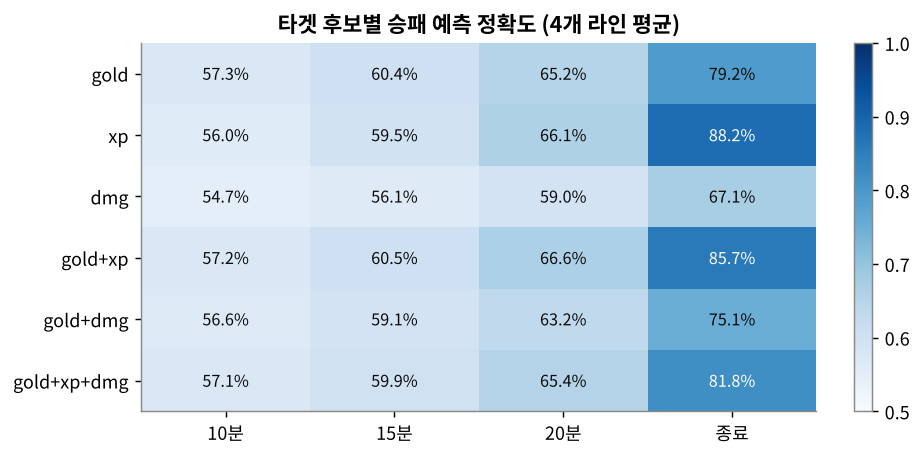
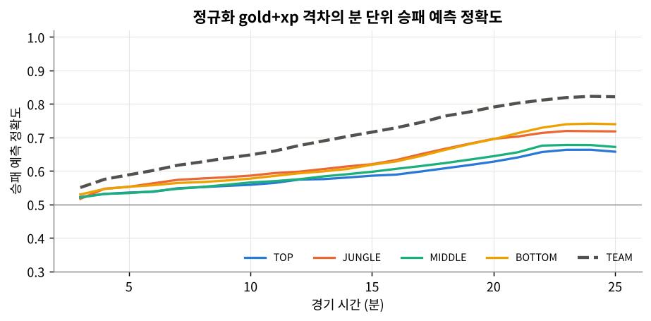
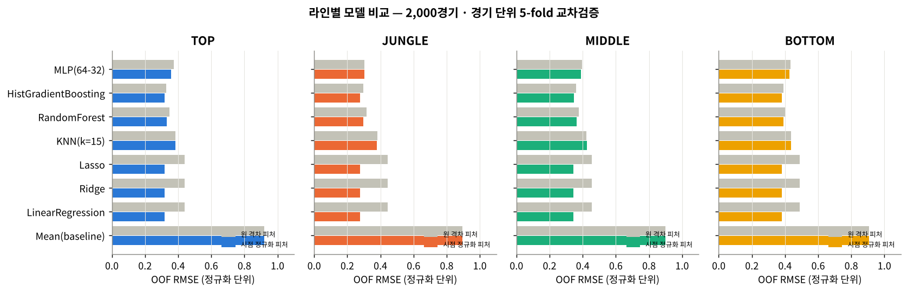
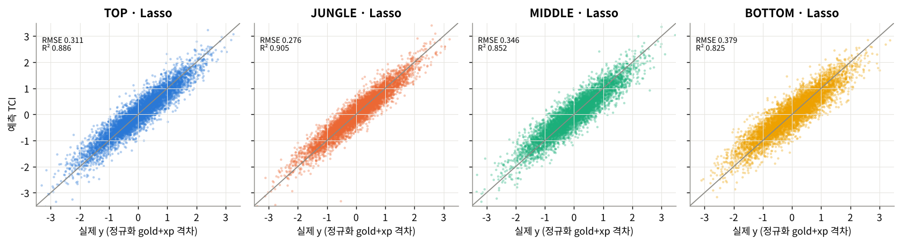
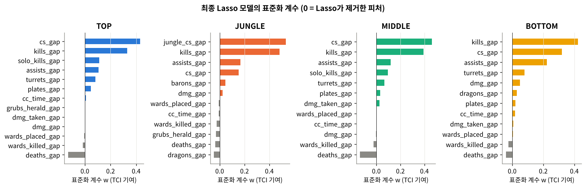
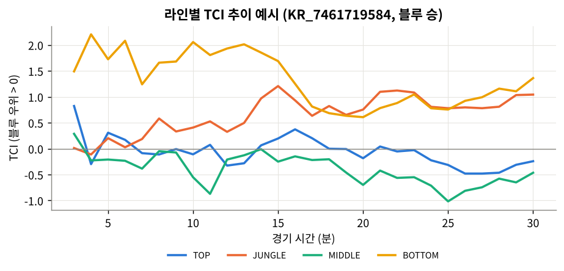
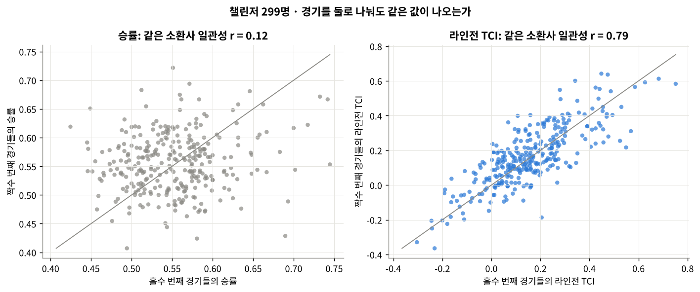
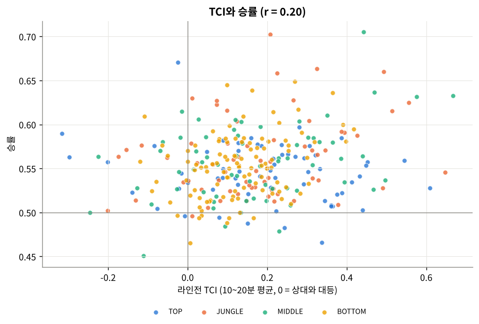
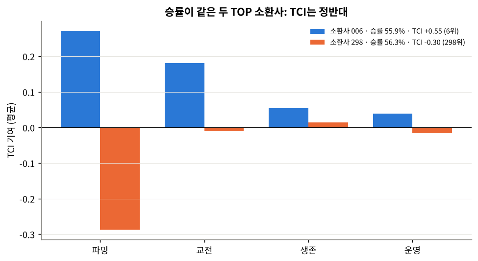

# 리그 오브 레전드 경기력 평가를 위한 설계 및 활용

## 1. 개 요

---

리그 오브 레전드(League of Legends, 이하 LoL)는 2022 항저우 아시안게임 정식 종목으로 채택될 만큼 대중성과 경쟁성이 검증된 게임이다. LoL을 플레이하는 가장 보편적인 방식은 5대 5 솔로랭크 매치다. 솔로랭크는 최대 2명까지만 함께 대기열에 들어갈 수 있으므로 팀원 대부분이 매 경기 무작위로 구성되며, 플레이어의 일차적인 목적은 개인 실력을 끌어올려 랭크를 높이는 데 있다. 최상위 티어에는 프로게이머와 스트리머도 다수 포함되는데, 이들에게 솔로랭크는 실전 감각을 유지하고 경기를 준비하는 개인 연습의 장이다. 실제로 LCK의 이상혁(Faker) 선수는 솔로랭크를 하지 못해 다른 팀보다 대회 준비에 불리한 점이 있었다고 언급한 바 있다[[1]](https://www.gamevu.co.kr/news/articleView.html?idxno=32152).

따라서 솔로랭크 매치를 분석할 때 단순한 승패 예측이나 팀워크 분석은 플레이 목적과 잘 맞지 않는다. 승패는 무작위로 배정된 9명의 영향을 크게 받고, 팀워크는 매 경기 새로 구성되기 때문이다. 그보다는 경기가 진행되는 동안 **각 라인에서 누가 얼마나 우위를 점했는지**를 과정 지표로 나타내는 것이 더 합리적인 분석 목적이다. 이 보고서는 특정 라인의 경기력을 분 단위 과정 지표로 표현하는 모델을 설계하고 그 성능을 검증한다.

### 1.1 분석 데이터

LoL 개발사인 Riot Games는 개발자 포털에서 API(Application Programming Interface) 형태로 경기 데이터를 무료로 제공한다[[2]](https://developer.riotgames.com/apis#match-v5). 이 연구는 경기 결과와 선수별 최종 기록을 담은 **match-v5** 데이터와, 1분 간격의 선수 상태 스냅숏(`participantFrames`) 및 시간순 사건 목록(`events`)을 담은 **timeline** 데이터를 함께 사용한다.

분석 데이터는 2025년 1월 8일부터 4월 7일까지 한국 서버(KR) 챌린저 티어 300명이 플레이한 53,279경기다. 여기서 챌린저 티어 300명은 2025년 4월 8일 기준이며, 합리적인 분석을 위해 이 중 20분 이상 진행된 **38,075경기**를 대상으로 한다. 대상 경기의 평균 길이는 28.1분(중앙값 27.7분, 최단 20.0분, 최장 55.9분)이고, 블루팀 승률은 52.0%다. 각 경기에서 3분부터 경기 종료 직전까지 매 분을 하나의 샘플로 사용하므로 라인마다 975,091개, 전체 3,900,364개의 분 단위 샘플이 만들어진다.

모든 소스코드는 [GitHub 저장소](https://github.com/AHNNTAE/lol-tci)에 공개했다(데이터 제외). 원본 JSON은 수십 GB에 달해 한 번에 메모리에 올릴 수 없으므로, 파일 쌍(`match_N.json`, `timeline_N.json`) 1,075개를 하나씩 읽어 분 단위 피처만 추출하고 압축 저장하는 전처리 단계(`extract_features.py`)를 두었다. 결과 피처 파일은 약 100MB다.

### 1.2 경기력 평가를 위한 기본 방향

선행연구[[3]](https://www.kci.go.kr/kciportal/ci/sereArticleSearch/ciSereArtiView.kci?sereArticleSearchBean.artiId=ART003327764)는 같은 데이터로 미드라이너의 경기력을 분 단위로 평가했다. 이 연구는 선행연구를 4개 라인(TOP, JUNGLE, MIDDLE, BOTTOM)으로 확장하여 라인별 **타임라인 기여도 지수(Timeline Contribution Index, 이하 TCI)**를 설계한다. BOTTOM은 원거리 딜러(ADC)와 서포터(SPT)로 이루어진 봇 듀오를 하나의 단위로 보고 두 선수의 기록을 합산한다.

라인별 TCI는 지도학습으로 만든다. 입력은 해당 라인의 행동 기록(CS, 킬, 데스, 시야, 포탑 등)이고, 출력은 그 시점 라인의 성장 우위를 나타내는 값이다. 모델은 "이 정도의 행동 기록이면 이 정도의 성장 우위에 해당한다"는 대응 관계를 학습하며, 학습된 모델이 내놓는 값이 TCI다.

$$
TCI_{LANE} (\vec{x}, t ; \theta) = f_{\theta}\big(\tilde{\vec{x}}_t\big) \approx y_t, ~~~\text{where}~~LANE \in \{ TOP,~JUNGLE,~MIDDLE,~BOTTOM\}
$$

여기서 $\vec{x}_t$는 경기 시작부터 $t$분까지의 블루−레드 누적 격차 벡터, $\tilde{\vec{x}}_t$는 이를 시점별로 정규화한 값, $y_t$는 2.1절에서 정의하는 타겟 변수, $\theta$는 모델 파라미터다.

### 1.3 분석 목적

이 연구의 목적은 세 가지다. 첫째, 솔로랭크에서 승패와 별개로 각 라인의 경기력을 분 단위로 비교할 수 있는 지표를 만든다. 둘째, TCI가 어떤 행동에 얼마나 가중치를 두는지 계수로 제시하여, 라인별로 우위를 만드는 핵심 행동이 무엇인지 해석할 수 있게 한다. 셋째, 4장에서 다루듯 TCI를 경기 흐름 시각화, 소환사별 라인전 역량 평가, 승패와 분리된 개인 기여 평가에 활용하는 방법을 제시한다.

---

## 2. 변수 설정

---

### 2.1 타겟 변수 설정

TCI를 지도학습으로 모델링하려면 경기력을 대변하는 출력값, 즉 타겟 변수($y$)가 필요하다. 후보는 타임라인에서 매 분 관측되는 세 가지 누적량, 곧 **골드**(`totalGold`), **경험치**(`xp`), **챔피언에게 가한 피해량**(`totalDamageDoneToChampions`)과 그 조합이다. 모든 후보는 블루 라인 값에서 레드 라인 값을 뺀 **누적 격차**로 정의했다.

두 개 이상의 지표를 합칠 때는 단위와 규모가 다르므로 정규화가 필요하다. 예를 들어 15분 BOTTOM의 골드 격차 RMS는 약 1,881, 경험치 격차 RMS는 약 1,229로 규모가 다르며, 그대로 더하면 골드가 결과를 지배한다. 또한 격차는 시간이 지날수록 커지므로(TOP 골드 격차 RMS: 5분 372 → 15분 1,465 → 25분 2,375) 같은 500골드 차이라도 5분과 25분의 의미가 다르다. 그래서 각 지표를 **해당 라인·해당 분의 RMS(제곱평균제곱근)**로 나눈 뒤 평균했다.

$$
y_t = \frac{1}{K}\sum_{k=1}^{K} \frac{\Delta s_{k,t}}{\mathrm{RMS}_{k}(t)}, \qquad \mathrm{RMS}_{k}(t) = \sqrt{\frac{1}{N_t}\sum_{i:\,|t_i-t|\le 2} \Delta s_{k,i}^2}
$$

평균을 빼는 일반적인 z-score 대신 RMS로만 나눈 이유는 **0 = 대등**이라는 부호의 의미를 보존하기 위해서다. 표본이 적은 분의 RMS가 흔들리지 않도록 $t\pm2$분의 샘플을 함께 사용했고, 30개 미만으로 남는 극후반부는 마지막 유효값을 썼다. 1~2분은 첫 미니언 웨이브 전후로 격차가 사실상 0이어서 RMS가 매우 작아지고 정규화가 불안정해지므로 제외했다. 정규화 상수는 교차검증의 각 fold 학습 데이터에서만 추정하여 검증 데이터의 정보가 섞이지 않게 했다.

타겟의 타당성은 `evaluate_y.py`의 방식을 확장해 38,075경기 전체로 검증했다. 각 후보에 대해 "블루 측 값이 0보다 크면 블루 승리"로 예측했을 때의 정확도를 라인별, 팀 전체별로, 그리고 10분·15분·20분·경기 종료 시점별로 계산했다.



| 타겟 후보 | 팀 10분 | 팀 15분 | 팀 20분 | 팀 종료 | 라인 평균 10분 | 라인 평균 15분 | 라인 평균 20분 | 라인 평균 종료 |
|---|---:|---:|---:|---:|---:|---:|---:|---:|
| gold | 64.4% | 71.4% | 78.7% | 98.3% | **57.3%** | 60.4% | 65.2% | 79.2% |
| xp | 63.1% | 69.6% | 77.4% | 97.2% | 56.0% | 59.5% | 66.1% | **88.2%** |
| dmg | 59.8% | 64.0% | 70.5% | 86.5% | 54.7% | 56.1% | 59.0% | 67.1% |
| **gold+xp** | **64.8%** | **71.6%** | **79.1%** | **98.4%** | 57.2% | **60.5%** | **66.6%** | 85.7% |
| gold+dmg | 63.5% | 69.8% | 76.8% | 95.4% | 56.6% | 59.1% | 63.2% | 75.1% |
| gold+xp+dmg | 64.5% | 71.2% | 78.3% | 97.3% | 57.1% | 59.9% | 65.4% | 81.8% |

(위 그림은 라인 평균 정확도다.)

최종 타겟은 **정규화한 골드+경험치 격차(gold+xp)**로 정했다. 근거는 다음과 같다.

- 팀 전체(5명 합산) 기준으로 gold+xp는 **10분·15분·20분·종료의 모든 시점에서 6개 후보 중 정확도 1위**다(15분 71.6%, 20분 79.1%, 종료 98.4%). 비교로, `evaluate_y.py`의 종료 시점 팀 골드(`goldEarned`) 기준 정확도는 98.3%다. 즉 이 지표는 경기의 우열을 가장 잘 반영한다.
- 라인 단위에서도 gold+xp는 15분(60.5%)과 20분(66.6%)에서 1위, 종료 시점(85.7%)에서 2위다. xp 단독은 종료 시점에는 가장 높지만 10~15분에는 gold보다 낮고, gold 단독은 초반에는 근소하게 높지만 종료 시점에는 79.2%로 떨어진다. gold+xp는 모든 시점에서 고르게 높은 균형형 후보다.
- 골드는 아이템, 경험치는 레벨로 이어지는 LoL의 두 가지 성장 자원이다. 두 값의 합은 "그 시점에 상대보다 얼마나 강해졌는가"를 가장 직접적으로 나타낸다. 피해량은 모든 시점에서 가장 낮았으며, 교전에 자주 참여하는 챔피언(포킹형 메이지 등)에서 크게 부풀고 이미 진 교전에서도 쌓일 수 있어 타겟보다는 입력 피처로 쓰는 편이 적절하다고 판단했다.

라인 단위 정확도가 팀 단위보다 낮은 것은 자연스럽다. 한 라인이 이겨도 나머지 라인이 지면 경기는 진다. 이것이 바로 승패와 분리된 라인별 지표가 필요한 이유이기도 하다. 아래 그림은 gold+xp의 분 단위 정확도로, 팀 합계는 시간이 갈수록 꾸준히 올라 25분에 약 82%에 이르고, 각 라인은 66~74% 수준까지 올라간다. JUNGLE과 BOTTOM이 TOP과 MIDDLE보다 승패와 더 밀접하다.



### 2.2 라인별 피처 설정

피처 방식은 누적·격차·시점·이벤트 중 `data_process_sample.py`가 사용한 **누적 격차(블루−레드)**로 통일했다. 누적 격차를 고른 이유는 세 가지다. 첫째, 타겟이 누적 격차이므로 입력과 출력이 같은 형식이 된다. 둘째, 구간(최근 1분) 값은 0이 대부분이어서 잡음이 크고, 이벤트 단위는 시점마다 길이가 달라 고정 길이 입력으로 만들기 어렵다. 셋째, 누적 격차는 "지금까지 쌓아 온 우위"라는 해석이 분명하다.

원본 `data_process_sample.py`는 10분 스냅숏 하나로 15분 골드 격차를 예측하는 구조였다. 이를 다음과 같이 변형했다(`tci_lane/data_process.py`).

1. 3분부터 경기 종료 직전까지 **매 분**을 샘플로 만들어 $TCI(\vec{x}, t)$의 $t$를 반영했다.
2. 프레임 스탯(CS, 피해량, CC 시간)과 이벤트 집계(킬, 데스, 어시스트, 솔로킬, 와드, 포탑 방패, 포탑, 오브젝트)를 모두 **해당 프레임의 실제 timestamp 이하**로만 누적하여 미래 정보 누출을 막았다. 원본이 킬 이벤트에 적용한 방식을 다른 이벤트로 확장한 것이다.
3. `teamPosition == "UTILITY"`를 BOTTOM에 합쳐 봇 듀오를 하나의 단위로 처리했다(원본과 동일).
4. 포탑 방패와 포탑 파괴는 `laneType`으로 해당 라인에 귀속시키고, 드래곤·유충/전령·바론은 팀 단위로 집계했다.
5. **골드와 경험치 자체는 피처에서 제외했다.** 타겟을 구성하는 값을 입력에 넣으면 모델이 사실상 답을 베끼게 되기 때문이다.

라인별 피처는 각 라인의 역할에 대한 도메인 지식을 바탕으로 공통 피처에 라인 고유 피처를 더해 구성했다.

| 구분 | 피처 | 근거 |
|---|---|---|
| 공통 | `minute`, `cs_gap`, `dmg_gap`, `kills_gap`, `deaths_gap`, `assists_gap`, `cc_time_gap`, `wards_placed_gap`, `wards_killed_gap` | CS와 킬·어시스트는 골드와 경험치의 직접적인 원천이고, 데스는 성장 손실(부활 대기 동안 CS·경험치 손실)을 뜻한다. 피해량과 CC는 교전 기여, 와드는 시야 장악을 나타낸다. |
| TOP | + `solo_kills_gap`, `dmg_taken_gap`, `plates_gap`, `turrets_gap`, `grubs_herald_gap` | 탑은 고립된 1:1 라인이므로 솔로킬, 받은 피해(라인전 체급), 포탑 방패·포탑 압박이 중요하다. 공허 유충과 전령은 탑 방향 오브젝트다. |
| JUNGLE | `cs_gap` 대신 `jungle_cs_gap` 중심, + `dragons_gap`, `grubs_herald_gap`, `barons_gap` | 정글러의 성장은 정글 몬스터 처치와 갱킹(킬·어시스트)에서 나오며, 에픽 몬스터 처치는 정글러의 핵심 임무다. 라인 미니언 CS도 보조 피처로 유지했다. |
| MIDDLE | + `solo_kills_gap`, `dmg_taken_gap`, `plates_gap`, `turrets_gap` | 미드는 짧은 라인에서 1:1 교전과 로밍이 번갈아 일어나며, 미드 포탑 방패는 획득 골드가 크다. |
| BOTTOM | + `dmg_taken_gap`, `plates_gap`, `turrets_gap`, `dragons_gap` | 2:2 라인전이라 킬·어시스트가 자주 발생하고, 서포터의 시야 활동이 크며, 드래곤 주도권과 직결된다. |

추가로, 누적 격차는 시간이 지날수록 분산이 커지므로 피처에도 타겟과 같은 **시점 정규화**를 적용할 수 있다(`TimeNormalizer`). 각 피처를 해당 분의 RMS로 나누면 "5분 CS 10개 차이"와 "25분 CS 10개 차이"가 각 시점의 전형적인 격차 대비 크기로 바뀐다. 3장에서는 원 격차 피처와 시점 정규화 피처를 모두 실험하여 비교했다.

---

## 3. 경기력 지표 모델링

---

### 3.1 모델 선정

입력은 고정 길이의 수치 벡터(라인별 13~14개 피처)이고 출력은 연속형 실수 하나이므로, 이 문제는 표준적인 **회귀 문제**다. 단순한 모델부터 복잡한 모델까지 같은 조건에서 비교했다.

| 계열 | 모델 | 핵심 원리 |
|---|---|---|
| 기준선 | Mean | 학습 데이터 타겟 평균을 항상 예측. 모델이 의미가 있는지 판단하는 하한선 |
| 선형 회귀 | LinearRegression, Ridge, Lasso | $\hat y = \mathbf{w}^\top \mathbf{x} + b$. Ridge는 L2 벌점, Lasso는 L1 벌점으로 계수를 줄인다 |
| 거리 기반 | KNN (k=15) | 피처 공간에서 가까운 15개 샘플 타겟의 거리 가중 평균 |
| 배깅 | RandomForest (300 trees) | 부트스트랩 표본으로 만든 결정나무 300개의 평균 |
| 부스팅 | HistGradientBoosting | 이전 나무들의 잔차를 다음 나무가 순차적으로 학습 (LightGBM과 같은 히스토그램 방식) |
| 신경망 | MLP (64-32) | 은닉층 2개(64, 32 노드, ReLU)의 다층 퍼셉트론, 조기 종료 사용 |

커널 회귀인 SVR(RBF)도 후보였으나 계산량이 표본 수의 제곱 이상으로 늘어나 대규모 비교에서는 제외했다(30경기 예비 실험에서는 상위권에 들지 못했다).

**검증 방법.** 같은 경기의 연속된 분 샘플은 서로 매우 비슷하므로, 샘플 단위로 무작위 분할하면 같은 경기가 학습과 검증에 동시에 들어가 성능이 부풀려진다. 그래서 **경기(match_id) 단위 GroupKFold 5-fold**를 사용했다. 모델 16개(8종 × 피처 방식 2종)를 4개 라인에서 모두 비교하는 단계는 계산 시간을 고려해 무작위로 뽑은 **2,000경기**(라인당 약 51,000 샘플)로 수행했고, 여기서 선정한 최종 모델은 **38,075경기 전체**로 다시 5-fold 교차검증하고 학습했다. 각 fold에서 타겟 정규화 상수, 피처 정규화 상수, 표준화(StandardScaler), Ridge·Lasso의 규제 강도를 모두 학습 데이터로만 정했다.

**손실함수와 평가지표.** 예측값 $\hat y$와 실제 타겟 $y$의 차이로 다음 지표를 계산했다. 모든 값은 정규화 단위이며, 1.0은 "그 시점의 전형적인 격차 하나만큼"을 뜻한다.

$$
\mathrm{MSE} = \frac{1}{n}\sum_i (y_i - \hat y_i)^2,\quad
\mathrm{RMSE} = \sqrt{\mathrm{MSE}},\quad
\mathrm{MAE} = \frac{1}{n}\sum_i |y_i - \hat y_i|,\quad
R^2 = 1 - \frac{\sum_i (y_i-\hat y_i)^2}{\sum_i (y_i-\bar y)^2}
$$

모델 선택 기준은 out-of-fold(OOF) **RMSE**이고, 학습 손실은 각 모델의 기본 손실(선형 계열은 MSE+규제항, 나무 계열은 분할 제곱오차, MLP는 MSE)을 사용했다. RMSE가 최저 모델 대비 1% 이내인 후보들은 사실상 동률로 보고, 그중 가장 단순하고 해석 가능한 모델(Lasso → Ridge → LinearRegression → 부스팅 → …)을 고르도록 규칙을 정했다.

**비교 결과 (2,000경기, OOF RMSE, 낮을수록 좋음).**

| 모델 | TOP 원격차 | TOP 정규화 | JUNGLE 원격차 | JUNGLE 정규화 | MIDDLE 원격차 | MIDDLE 정규화 | BOTTOM 원격차 | BOTTOM 정규화 |
|---|---:|---:|---:|---:|---:|---:|---:|---:|
| Mean (기준선) | 0.921 | 0.921 | 0.896 | 0.896 | 0.900 | 0.900 | 0.907 | 0.907 |
| LinearRegression | 0.438 | 0.319 | 0.445 | 0.277 | 0.456 | 0.344 | 0.489 | 0.380 |
| Ridge | 0.438 | 0.319 | 0.445 | 0.277 | 0.456 | 0.344 | 0.489 | 0.380 |
| **Lasso** | 0.438 | **0.319** | 0.445 | **0.277** | 0.456 | **0.344** | 0.489 | **0.380** |
| KNN (k=15) | 0.385 | 0.384 | 0.383 | 0.379 | 0.422 | 0.425 | 0.436 | 0.437 |
| RandomForest | 0.348 | 0.333 | 0.315 | 0.298 | 0.375 | 0.363 | 0.400 | 0.391 |
| HistGradientBoosting | 0.329 | 0.320 | 0.296 | 0.277 | 0.359 | 0.346 | 0.389 | 0.382 |
| MLP (64-32) | 0.372 | 0.358 | 0.303 | 0.302 | 0.396 | 0.391 | 0.434 | 0.426 |



결과에서 세 가지를 확인할 수 있다.

첫째, **시점 정규화 피처가 모든 라인에서 오차를 줄였다.** 효과는 선형 모델에서 특히 크다(JUNGLE 선형 0.445 → 0.277). 원 격차 피처를 쓰면 피처는 시간이 갈수록 커지는데 타겟은 시점별로 정규화되어 있어서, 같은 CS 격차에 대한 타겟 반응이 시간마다 달라진다. 선형 모델은 이런 시간 의존적인 비율을 표현할 수 없기 때문에, 원 격차에서는 `minute`과의 상호작용을 스스로 학습하는 부스팅·랜덤포레스트가 선형 모델보다 훨씬 좋았다(TOP 0.329 vs 0.438). 입력과 출력을 같은 시점 기준으로 맞추자 관계가 거의 선형이 되었다.

둘째, **시점 정규화 이후에는 선형 모델과 부스팅이 사실상 같은 성능이다.** 선형 계열 3종은 소수점 셋째 자리까지 같고, HistGradientBoosting과의 차이도 0.001~0.002(0.3~0.6%)에 불과하다. 복잡한 비선형 모델이 추가로 설명할 구조가 거의 남지 않았다는 뜻이며, 실제 관계가 "CS·킬·어시스트가 골드·경험치를 만든다"는 가산적 구조라는 도메인 지식과도 맞는다.

셋째, 동률 규칙에 따라 **4개 라인 모두 시점 정규화 + Lasso 회귀를 최종 모델로 선정**했다. 성능이 같다면 계수로 바로 해석할 수 있는 선형 모델이 TCI의 목적(어떤 행동이 우위를 만드는지 설명)에 더 적합하고, 4개 라인이 같은 구조를 쓰므로 라인 간 계수를 직접 비교할 수 있다.

**최종 모델: 시점 정규화 Lasso 회귀.** 파이프라인은 세 단계로 이루어진다.

1. **TimeNormalizer**: 피처 $x_{j,t}$를 학습 데이터에서 구한 $\mathrm{RMS}_j(t)$로 나눈다. $\tilde x_{j,t} = x_{j,t}/\mathrm{RMS}_j(t)$ (`minute`은 그대로 둔다)
2. **StandardScaler**: 각 피처를 평균 0, 표준편차 1로 표준화한다. $z_j = (\tilde x_j - \mu_j)/\sigma_j$
3. **Lasso**: 다음 목적함수를 최소화하는 $\mathbf{w}, b$를 구한다.

$$
\min_{\mathbf{w},\,b}~ \frac{1}{2n}\sum_{i=1}^{n}\big(y_i - \mathbf{w}^\top\mathbf{z}_i - b\big)^2 + \alpha \lVert \mathbf{w} \rVert_1
$$

L1 벌점 $\alpha\lVert\mathbf{w}\rVert_1$은 계수의 절댓값 합에 비례하므로, 기여가 작은 피처의 계수를 **정확히 0**으로 만들 수 있다(Ridge의 L2 벌점은 계수를 작게 만들 뿐 0으로 만들지는 않는다). 해는 좌표하강법(coordinate descent)으로 구하는데, 계수 하나씩 돌아가며 나머지를 고정한 채 소프트 임계값 연산 $w_j \leftarrow S(\rho_j, \alpha) = \mathrm{sign}(\rho_j)\max(|\rho_j|-\alpha, 0)$으로 갱신한다. 여기서 $\rho_j$는 피처 $j$와 부분 잔차의 상관이다. $\alpha$는 학습 데이터 내부 5-fold 교차검증(`LassoCV`)으로 정했다.

전체 데이터로 학습한 최종 모델의 $\alpha$는 0.0006~0.0008로 매우 작다. 표본이 97만 개로 충분하면 과적합 위험이 작아 규제가 거의 필요 없기 때문이며, 그래서 Lasso·Ridge·일반 선형회귀의 결과가 사실상 같아졌다. 반대로 30경기(라인당 722 샘플)로 수행한 예비 실험에서는 $\alpha$가 0.01~0.04로 커서 Lasso가 피처의 절반 가까이를 0으로 만들었다. 데이터 규모에 따라 규제의 역할이 달라진다는 점을 보여 준다.

최종 TCI는 다음과 같이 계수와 정규화된 행동 기록의 가중합으로 해석된다.

$$
TCI_{LANE}(\vec{x}, t) = b + \sum_j w_j \cdot \frac{x_{j,t}/\mathrm{RMS}_j(t) - \mu_j}{\sigma_j}
$$

### 3.2 모델링 결과

아래는 최종 모델을 **38,075경기 전체**로 경기 단위 5-fold 교차검증한 결과다.

| 라인 | MSE | RMSE | MAE | $R^2$ | 기준선 RMSE | RMSE 3–10분 | RMSE 11–20분 | RMSE 21분+ |
|---|---:|---:|---:|---:|---:|---:|---:|---:|
| TOP | 0.097 | 0.311 | 0.241 | 0.886 | 0.920 | 0.287 | 0.281 | 0.367 |
| JUNGLE | 0.076 | 0.276 | 0.215 | 0.905 | 0.896 | 0.240 | 0.282 | 0.301 |
| MIDDLE | 0.120 | 0.346 | 0.271 | 0.852 | 0.899 | 0.314 | 0.325 | 0.400 |
| BOTTOM | 0.143 | 0.379 | 0.296 | 0.825 | 0.905 | 0.352 | 0.356 | 0.431 |



(산점도는 라인별로 무작위 6,000개 샘플만 표시했다.)

네 라인 모두 $R^2$가 0.83~0.91로, 골드·경험치를 직접 보지 않고 행동 기록만으로 골드+경험치 우위 변동의 83~91%를 설명한다. RMSE는 평균 기준선 대비 약 58~69% 낮다. 원단위로 환산하면 15분 TOP의 RMSE 0.311은 골드 기준 약 460골드(RMS 1,465 × 0.311), 경험치 기준 약 380에 해당한다. JUNGLE이 가장 정확한 이유는 정글러의 자원이 정글 CS와 킬·어시스트라는 소수의 명확한 원천에서 나오기 때문이다. BOTTOM은 두 선수를 합산하므로 서포터 아이템 수입, 경험치 분배 등 피처로 잡히지 않는 변동이 더 크다. 모든 라인에서 21분 이후 오차가 커지는데, 후반에는 라인 구분이 흐려지고 한타·스플릿 푸시·바론 등 라인 외 요인이 늘어나며, 오래 이어지는 경기 수 자체가 적기 때문이다(20분 시점 38,075경기 → 30분 11,486경기 → 40분 802경기).



| 피처 (표준화 계수 $w$) | TOP | JUNGLE | MIDDLE | BOTTOM |
|---|---:|---:|---:|---:|
| cs_gap | **0.431** | 0.153 | **0.463** | 0.321 |
| jungle_cs_gap | – | **0.534** | – | – |
| kills_gap | 0.329 | 0.482 | 0.394 | **0.423** |
| assists_gap | 0.107 | 0.169 | 0.120 | 0.223 |
| deaths_gap | −0.131 | −0.037 | −0.136 | −0.040 |
| solo_kills_gap | 0.111 | – | 0.096 | – |
| turrets_gap | 0.081 | – | 0.068 | 0.079 |
| plates_gap | 0.046 | – | 0.033 | 0.021 |
| dmg_gap | 0.000 | 0.025 | −0.003 | 0.051 |
| dmg_taken_gap | 0.001 | – | 0.027 | 0.008 |
| cc_time_gap | 0.008 | −0.008 | −0.001 | 0.020 |
| wards_placed_gap | −0.004 | −0.006 | 0.000 | 0.004 |
| wards_killed_gap | −0.016 | −0.025 | −0.022 | −0.023 |
| dragons / grubs_herald / barons | – / 0.003 / – | −0.045 / −0.029 / 0.048 | – | 0.029 / – / – |

(– 는 해당 라인에서 사용하지 않은 피처)

계수는 라인별 역할에 대한 도메인 지식과 잘 맞는다.

- **TOP**은 CS(0.431)가 가장 크고, 킬(0.329)과 솔로킬(0.111)이 별도로 기여한다. 솔로킬 계수가 따로 살아남은 것은 1:1 라인에서 혼자 따낸 킬이 경험치를 독점하여 일반 킬보다 성장 우위가 크다는 뜻이다. 데스(−0.131)의 비중도 커서 고립된 라인에서 한 번의 사망이 큰 손실임을 보여 준다.
- **JUNGLE**은 정글 CS(0.534)와 킬(0.482)이 쌍두마차를 이루고 어시스트(0.169)가 뒤따른다. 정글 동선 관리와 갱킹 성공이 함께 중요하다. 데스 계수(−0.037)가 작은 것은 정글러는 죽어도 라인 CS를 잃지 않기 때문으로 해석된다.
- **MIDDLE**은 CS(0.463)와 킬(0.394)이 중심이고 솔로킬(0.096), 포탑(0.068)이 뒤따른다. TOP과 비슷한 1:1 라인 구조지만 킬과 어시스트(0.120) 비중이 더 커서 로밍의 영향이 드러난다.
- **BOTTOM**은 킬(0.423)이 CS(0.321)보다 크고, 어시스트(0.223)와 피해량(0.051)이 다른 라인보다 크다. 2:2 교전이 잦은 봇 라인의 특성이다.
- 와드 제거(`wards_killed_gap`)는 모든 라인에서 작은 음수다. 와드를 지우러 다니는 시간만큼 파밍 시간이 줄어드는 기회비용으로 볼 수 있지만, 크기가 작아 해석에 무게를 두기는 어렵다. 같은 이유로 JUNGLE의 드래곤·유충 계수(음수)도 정글 CS·킬과 강하게 상관된 상태에서 남은 작은 보정으로 보아야 하며, 계수를 인과 효과로 해석해서는 안 된다.

**TCI의 승패 설명력.** 15분 시점 OOF 예측 TCI로 경기 승패를 구분하는 ROC-AUC는 TOP 0.618, JUNGLE 0.671, MIDDLE 0.640, BOTTOM 0.660이다. 실제 타겟(15분 gold+xp 격차)의 AUC(TOP 0.623, JUNGLE 0.667, MIDDLE 0.638, BOTTOM 0.665)와 거의 같다. TCI가 골드·경험치를 직접 보지 않고도 성장 우위가 지닌 승패 정보를 그대로 재현한다는 뜻이다. 한 라인만으로 승패를 설명하는 정도가 0.6대에 머무는 것은 1장에서 말한 대로 솔로랭크 승패가 10명 전체의 결과이기 때문이며, TCI가 승패 예측이 아니라 라인 단위 과정 지표를 목표로 하는 이유이기도 하다.

**한계.** (1) 모델 비교는 2,000경기 한 번의 5-fold로 수행했으므로 후보 간 차이가 0.002 이하인 경우는 우열을 가릴 수 없다(그래서 동률 규칙을 두었다). (2) 경기 단위 무작위 분할이므로 같은 기간 안의 일반화만 검증했고, 이후 패치나 다른 티어에 대한 일반화는 기간별 홀드아웃으로 별도 검증해야 한다. (3) 같은 라인의 블루·레드를 격차 하나로 다루므로 TCI는 "상대 대비 우위"이며 절대 실력이 아니다. (4) 챔피언 상성과 조합은 반영하지 않았다.

---

## 4. TCI 모델의 활용

### 4.1 한 경기 들여다보기

라인별 TCI를 분 단위로 그리면 어느 라인이 언제 우위를 잡았고 언제 뒤집혔는지 한눈에 보인다. 아래 예시 경기(KR_7461719584, 블루 승)에서 블루 BOTTOM은 라인전 내내 압도적인 우위(15분까지 TCI 1.2~2.2)를 보이다가 17~20분에 0.6대로 줄었고, 이후 다시 벌려 30분에 1.36으로 마쳤다. JUNGLE은 0 근처에서 출발해 15분 1.21까지 꾸준히 우위를 쌓은 뒤 끝까지 유지했다. 반면 TOP은 경기 내내 대등했고 26~27분에는 −0.48까지 밀렸으며, MIDDLE은 거의 모든 시점에서 열세였다(11분 −0.87, 25분 −1.02). 즉 이 경기는 봇·정글 쪽의 우위로 이긴 경기이며, 블루 미드라이너는 승리했지만 라인 단위로는 밀린 경기였다. TCI의 기울기가 급변하는 분(예: BOTTOM 15~17분)을 "전환점"으로 정의하면 리플레이에서 어느 장면을 다시 봐야 하는지 자동으로 짚어 줄 수 있다.



### 4.2 소환사의 실력을 TCI로 평가하기

TCI의 최종 목적은 승패와 분리하여 **소환사의 실력을 객관적으로 설명**하는 것이다. 분석 대상 챌린저 목록(`puuid_challengers.txt`, 299명)의 소환사가 참여한 경기마다, 그 소환사 쪽에서 본 라인 TCI(블루면 그대로, 레드면 부호를 바꿈)를 구하고 **10~20분 평균**을 그 경기의 "라인전 TCI"로 정의했다. 소환사의 TCI는 주 라인(경기의 평균 86%) 경기들의 라인전 TCI 평균이다. 299명 모두 30경기 이상 기록이 있었고(중앙값 226경기), 이름 대신 TCI 순위에 따라 "소환사 001~299"로 익명 표기했다(`analyze_players.py`, 결과는 `results_players/`).

**결과 1: TCI는 승률보다 훨씬 일관되게 같은 사람을 알아본다.** 실력 지표라면 같은 소환사의 경기를 둘로 나눠도 비슷한 값이 나와야 한다. 각 소환사의 경기를 시간 순으로 홀수 번째와 짝수 번째로 나누고, 두 묶음에서 계산한 값이 소환사들 사이에서 얼마나 일치하는지 상관계수 $r$로 비교했다.

| 지표 | 홀수 번째 경기 vs 짝수 번째 경기의 일치도 ($r$) |
|---|---:|
| 승률 | 0.12 |
| **라인전 TCI** | **0.79** |



승률은 같은 사람인데도 두 묶음의 값이 거의 맞지 않는다(0.12). 한 판의 결과가 이기거나 지는 0/1 하나뿐이고 무작위 팀원 9명의 영향이 크게 섞이기 때문이다. 반면 라인전 TCI는 0.79로 매우 일관되다. 매 분의 행동 기록을 쓰기 때문에 같은 판 수로도 훨씬 많은 정보를 담고, 팀원의 영향이 적은 라인 단위 지표이기 때문이다. 즉 **TCI는 그 소환사가 꾸준히 가진 실력을 재고, 승률은 운이 많이 섞인 결과를 잰다.**

TCI와 승률의 상관은 0.20으로 양의 관계다. TCI가 높은 소환사가 대체로 더 많이 이기지만, 승률만으로는 보이지 않는 차이가 크다는 뜻이다. 299명 중 258명의 TCI가 양수(평균 +0.16)였는데, 챌린저는 대부분 라인 상대보다 앞선다는 자연스러운 결과다. 그중 13명은 라인전을 이기면서도 승률이 50%에 못 미쳤다.



**결과 2: 승률이 같아도 실력의 모습은 정반대일 수 있다.** 같은 라인에서 150경기 이상, 승률 차이 1%p 이내인 쌍 중 TCI 차이가 가장 큰 두 TOP 소환사를 비교했다.

| | 경기 수 | 승률 (299명 중 순위) | 라인전 TCI (순위) | 파밍 기여 | 교전 기여 |
|---|---:|---:|---:|---:|---:|
| 소환사 006 | 152 | 55.9% (129위) | **+0.55 (6위)** | +0.27 | +0.18 |
| 소환사 298 | 309 | 56.3% (116위) | **−0.30 (298위)** | −0.29 | −0.01 |



두 사람은 승률로는 구별되지 않지만 TCI로는 거의 양 끝에 있다. 최종 모델이 선형이므로 TCI를 행동 범주별 기여(파밍: CS·정글 CS / 교전: 킬·어시스트·솔로킬·피해량·CC / 생존: 데스·받은 피해 / 운영: 포탑·오브젝트·와드)로 정확히 쪼갤 수 있다. 소환사 006은 CS와 교전 모두에서 라인 상대를 앞서는 "라인전으로 이기는" 유형이고, 소환사 298은 라인에서 CS를 크게 양보하면서도 한타·운영 같은 라인 밖의 기여로 이기는 유형이다. 따라서 TCI는 **누가 라인전을 더 잘하는지**와 함께 **어떻게 이기는지**를 설명해 준다. 298의 입장에서는 "CS 손해를 줄이면 승률을 더 올릴 여지가 크다"는 구체적인 피드백이 된다.

**해석의 한계.** BOTTOM은 원거리 딜러와 서포터가 같은 봇 듀오 TCI를 공유하므로 개인보다 듀오 단위 평가에 가깝다. 또한 챌린저의 라인 상대는 대체로 그보다 낮은 티어이므로 TCI의 절대값보다 소환사 간 상대 비교에 의미를 두어야 한다.

### 4.3 그 밖의 활용

**행동 단위 피드백.** TCI는 피처별 기여 $w_j z_j$의 합으로 정확히 분해되므로, 경기 하나에서도 "15분 TOP TCI −0.8 중 CS 격차가 −0.5, 데스가 −0.3"처럼 무엇 때문에 밀렸는지 설명할 수 있다.

**실시간 예측과 확장.** TCI는 매 분 타임라인 프레임만으로 계산되므로 관전·방송 화면에 라인별 우위 게이지로 띄울 수 있다. 향후에는 챔피언별 TCI로 숙련도를 비교하거나, 시계열 모델(GRU 등)로 이전 분의 흐름까지 반영하고 기간별 홀드아웃으로 패치 변화에 대한 강건성을 검증하여 TCI를 정교화할 수 있다.

---

### 참고문헌 및 자료

1. 김지만, “[LCK 현장] 패배한 페이커, ‘솔로랭크가 막혀 준비에 아쉬움 있었다’”, 게임뷰, 2024.04.04. https://www.gamevu.co.kr/news/articleView.html?idxno=32152
2. Riot Games Developer Portal, MATCH-V5 API. https://developer.riotgames.com/apis#match-v5
3. 선행연구 (KCI). https://www.kci.go.kr/kciportal/ci/sereArticleSearch/ciSereArtiView.kci?sereArticleSearchBean.artiId=ART003327764
4. Tibshirani, R. (1996). Regression Shrinkage and Selection via the Lasso. *Journal of the Royal Statistical Society: Series B*, 58(1), 267–288.
5. Pedregosa, F. et al. (2011). Scikit-learn: Machine Learning in Python. *JMLR*, 12, 2825–2830.

### 재현

모든 소스코드는 GitHub 저장소(https://github.com/AHNNTAE/lol-tci)에 있으며(데이터 제외), 다음 명령으로 이 보고서의 표와 그림을 그대로 재생성할 수 있다.

```bash
pip install -r requirements.txt
python extract_features.py --data match_data --workers 2      # 원본 JSON → 피처 파일 (약 6분)
python run_all.py --features results/minute_features_full.csv.gz \
                  --end results/end_of_game_full.csv.gz --out results_full
python extract_players.py --data match_data --workers 2         # 경기별 소환사 정보
python analyze_players.py                                       # 4.2절 소환사 분석
```

30경기 예비 실험 결과는 `results/` 폴더에 남겨 두었다(`python run_all.py --data data --out results`).
