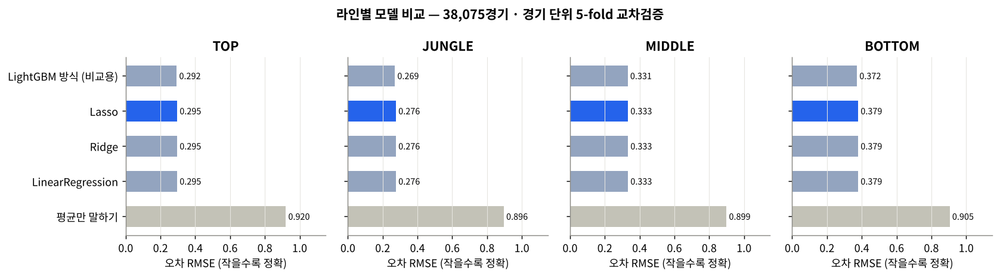
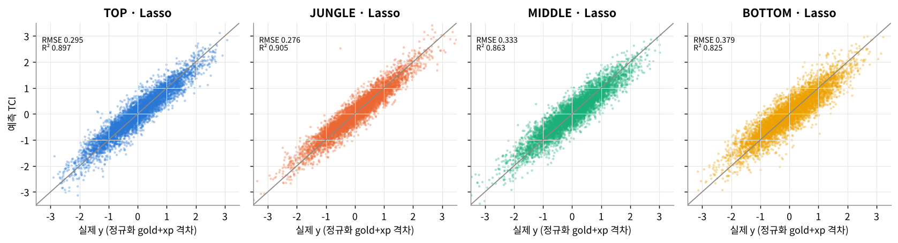
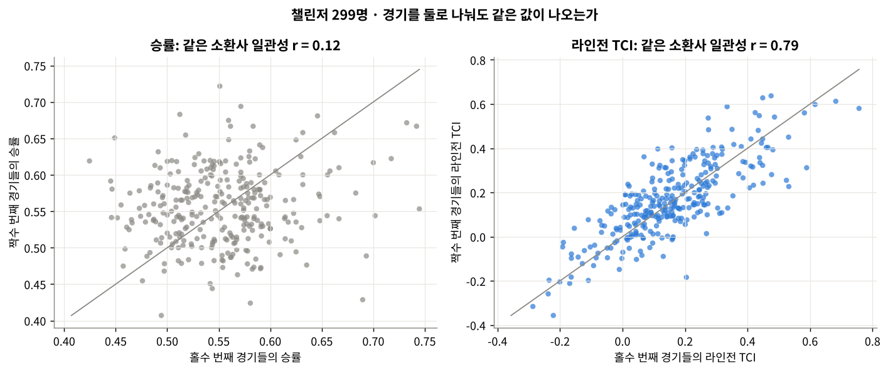
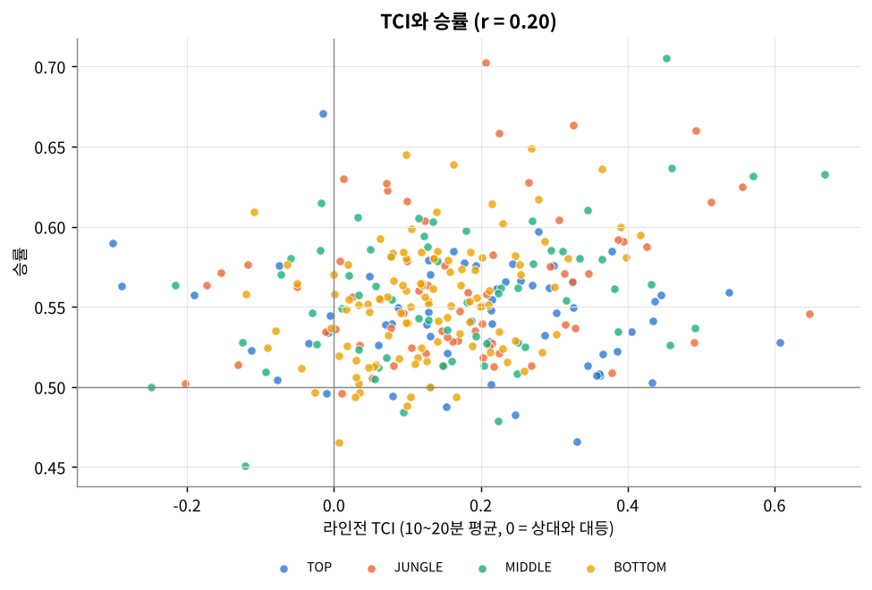

# 리그 오브 레전드 경기력 평가를 위한 설계 및 활용

## 1. 개 요

---

리그 오브 레전드(League of Legends, 이하 LoL)는 2022 항저우 아시안게임 정식 종목이 될 만큼 인기 있는 게임이다. LoL에서 가장 많이 하는 방식은 5대 5 솔로랭크다. 솔로랭크는 최대 2명까지만 같이 들어갈 수 있어서, 팀원 대부분이 매 판 무작위로 정해진다. 프로게이머와 스트리머도 솔로랭크를 많이 하는데, 이들에게 솔로랭크는 감각을 유지하고 경기를 준비하는 연습 공간이다. 실제로 LCK의 이상혁(Faker) 선수는 솔로랭크를 하지 못해 대회 준비가 불리했다고 말한 적이 있다[[1]](https://www.gamevu.co.kr/news/articleView.html?idxno=32152).

솔로랭크에서는 팀원이 매번 바뀌기 때문에, 이겼다고 내가 잘한 것도 아니고 졌다고 내가 못한 것도 아니다. 그래서 이 보고서는 승패를 맞히는 대신, **각 라인에서 상대보다 얼마나 앞섰는지**를 1분마다 숫자로 보여 주는 지표를 만든다.

### 1.1 분석 데이터

Riot Games는 개발자 사이트에서 경기 데이터를 무료로 제공한다[[2]](https://developer.riotgames.com/apis#match-v5). 이 연구는 두 가지를 사용한다.

- **match 데이터**: 경기 결과와 선수별 최종 기록
- **timeline 데이터**: 1분마다의 선수 상태(골드, 경험치, CS 등)와 킬·와드·포탑 같은 사건 기록

대상은 2025년 1월 8일부터 4월 7일까지 한국 서버 챌린저 300명(2025년 4월 8일 기준)이 플레이한 53,279경기 중, 20분 이상 진행된 **38,075경기**다. 경기마다 3분부터 끝날 때까지 1분에 한 줄씩 기록을 뽑아, 전체 약 390만 줄(라인마다 약 97만 줄)의 데이터를 만들었다.

모든 코드는 [GitHub 저장소](https://github.com/AHNNTAE/lol-tci)에 있다(데이터 제외). 원본 데이터가 수십 GB라서, 먼저 필요한 값만 뽑아 약 125MB짜리 파일로 줄였다(`extract_features.py`).

### 1.2 경기력 평가를 위한 기본 방향

선행연구[[3]](https://www.kci.go.kr/kciportal/ci/sereArticleSearch/ciSereArtiView.kci?sereArticleSearchBean.artiId=ART003327764)는 같은 데이터로 미드라이너의 경기력을 1분 단위로 평가했다. 이 연구는 이를 TOP, JUNGLE, MIDDLE, BOTTOM 4개 라인으로 넓혀 **타임라인 기여도 지수**(Timeline Contribution Index, 이하 TCI)를 만든다. BOTTOM은 원거리 딜러와 서포터를 한 팀으로 보고 두 사람 기록을 합쳤다.

TCI는 지도학습으로 만든다. 지도학습은 **문제와 정답을 많이 보여 주고, 둘 사이의 규칙을 배우게 하는 방법**이다.

- 문제(입력): 그 라인의 행동 기록 (CS, 킬, 데스 등)
- 정답(출력): 그 시점에 상대보다 얼마나 성장했는지

모델은 "이렇게 행동했으면 이만큼 앞서 있다"는 규칙을 배우고, 그 모델이 내놓는 값이 TCI다.

### 1.3 분석 목적

1. 승패와 상관없이 라인별 경기력을 1분마다 비교할 수 있는 지표를 만든다.
2. 라인마다 어떤 행동이 중요한지 보여 준다.
3. TCI로 소환사의 실력을 승률보다 공정하게 평가해 본다(4장).

---

## 2. 변수 설정

---

### 2.1 타겟 변수 설정

모델이 맞힐 정답을 **타겟 변수**($y$)라고 한다. 후보는 1분마다 기록되는 세 가지 값과 그 조합, 모두 6개다.

- 골드: 아이템을 사는 돈
- 경험치: 레벨을 올리는 값
- 챔피언에게 준 피해량

모든 값은 **블루 선수 값 − 레드 선수 값**, 즉 상대와의 차이로 계산했다. 0보다 크면 블루가 앞선 것이다.

**좋은 정답을 고른 방법.** 수업 예제 코드(`evaluate_y.py`)처럼, "이 값이 0보다 크면 블루가 이긴다"고 예측했을 때 얼마나 맞는지 38,075경기로 확인했다.


| 후보 | 팀 15분 | 팀 경기 종료 | 라인 15분 | 라인 20분 |
|---|---:|---:|---:|---:|
| 골드 | 71.4% | 98.3% | 60.4% | 65.2% |
| 경험치 | 69.6% | 97.2% | 59.5% | 66.1% |
| 피해량 | 64.0% | 86.5% | 56.1% | 59.0% |
| **골드 + 경험치** | **71.6%** | **98.4%** | **60.5%** | **66.6%** |
| 골드 + 피해량 | 69.8% | 95.4% | 59.1% | 63.2% |
| 골드 + 경험치 + 피해량 | 71.2% | 97.3% | 59.9% | 65.4% |

(그림은 라인 평균, 표는 팀 합계와 라인 평균이다. 모든 시점의 값은 `results_full/target_candidates.csv`에 있다.)

정답은 **골드 + 경험치 차이**로 정했다.

- 팀 합계로 보면 10분, 15분, 20분, 경기 종료 **모든 시점에서 1등**이다. 경기가 끝났을 때는 98.4% 경기에서 승패와 일치했다.
- 골드는 아이템, 경험치는 레벨이다. 둘을 합치면 "상대보다 얼마나 강해졌나"를 가장 잘 나타낸다.
- 피해량은 모든 시점에서 가장 낮았다. 싸움을 자주 하는 챔피언이면 많이 쌓이고, 진 싸움에서도 쌓이기 때문이다. 그래서 피해량은 정답이 아니라 입력으로 썼다.

**시간대별로 눈금을 맞춘 이유.** 차이는 시간이 갈수록 커진다. TOP에서 보통 벌어지는 골드 차이는 5분에 약 370, 25분에 약 2,380이다. 그래서 같은 500골드라도 5분에는 큰 차이, 25분에는 작은 차이다. 그래서 **그 시간대에 보통 벌어지는 차이로 나눠** 눈금을 맞췄다. 5분에 370골드 앞서도 1.0, 25분에 2,380골드 앞서도 1.0이 된다. 골드와 경험치를 이렇게 바꿔 평균 낸 것이 정답 $y$다. z-score와 비슷한 아이디어인데, 평균은 빼지 않고 나누기만 해서 0이 "대등"이라는 뜻을 유지했다.


위 그림처럼 팀 합계는 25분쯤 약 82%까지 맞히지만, 라인 하나만으로는 66–74%다. 한 라인이 이겨도 다른 라인이 지면 질 수 있기 때문이다. 이것이 승패와 따로 라인별 지표가 필요한 이유다.

### 2.2 라인별 피처 설정

**피처**($\vec{x}$)는 모델에 넣는 입력값이다. 수업 예제 코드(`data_process_sample.py`)처럼 모든 입력을 "경기 시작부터 그 시점까지 쌓인 값의 차이(블루 − 레드)", 즉 **누적 격차**로 통일했다. 정답과 같은 방식이라 짝이 맞고, "지금까지 쌓아 온 차이"라서 뜻이 분명하기 때문이다.

예제 코드에서 바꾼 점은 다음과 같다(`tci_lane/data_process.py`).

1. 10분 한 시점이 아니라 **1분마다** 기록을 뽑았다.
2. 킬·와드 같은 사건은 그 시점까지 일어난 것만 셌다. 미래 정보가 섞이지 않게 하기 위해서다.
3. **골드와 경험치는 입력에서 뺐다.** 정답을 입력에 넣으면 모델이 답을 베끼기 때문이다.

라인마다 중요한 게 다르므로, 공통 입력에 라인별 입력을 더했다.

| 라인 | 입력 | 이유 |
|---|---|---|
| 공통 | CS, 킬, 데스, 어시스트, 챔피언 피해량, CC 시간, 와드 설치·제거 | 골드·경험치를 버는 방법(CS·킬·어시스트)과 잃는 방법(데스) |
| TOP | + 솔로킬, 받은 피해, 포탑 방패, 포탑 파괴, **라인전 성적** | 혼자 맞서는 1:1 라인이라 라인전 실력이 중요하다 |
| JUNGLE | + 정글 몬스터, 드래곤, 유충·전령, 바론, **갱킹** | 정글 몬스터 사냥, 다른 라인 도와주기, 큰 오브젝트가 핵심이다 |
| MIDDLE | + 솔로킬, 받은 피해, 포탑 방패, 포탑 파괴, **라인전 성적, 로밍, 킬 관여율** | 1:1 라인전과 다른 라인 지원(로밍)을 모두 한다 |
| BOTTOM | + 받은 피해, 포탑 방패, 포탑 파괴, 드래곤 | 2:2 라인이라 싸움이 잦고 드래곤과 가깝다 |

새로 만든 입력은 다음과 같이 계산했다.

- **라인전 성적**: 포탑 방패가 사라지는 **14분까지**의 CS, 솔로킬, 데스 차이. 14분 이후에는 그 값으로 고정했다.
- **갱킹**: 정글러가 **라인 위**(탑·미드·바텀 길)에서 킬이나 어시스트를 한 횟수. 킬 기록에 있는 지도 좌표로 위치를 판단했다.
- **로밍**: 미드라이너가 **탑이나 바텀 라인**에서 킬이나 어시스트를 한 횟수.
- **킬 관여율**: (내 킬 + 어시스트) ÷ 우리 팀 전체 킬.

갱킹과 로밍은 지도를 대략 나눠서 판단했기 때문에, 라인과 정글 경계의 싸움은 조금 틀릴 수 있다.

입력도 정답처럼 **그 시간대의 보통 차이로 나눠** 눈금을 맞췄다. "5분의 CS 10개 차이"와 "25분의 CS 10개 차이"는 의미가 다르기 때문이다.

---

## 3. 경기력 지표 모델링

---

### 3.1 모델 선정

입력도 숫자, 정답도 숫자 하나이므로 숫자를 예측하는 **회귀** 문제다. 다음 모델을 같은 조건에서 비교했다.

| 모델 | 쉽게 말하면 |
|---|---|
| 평균만 말하기 (기준선) | 항상 평균값만 말한다. 이것보다 못하면 의미가 없다. |
| LinearRegression | 행동마다 점수(가중치)를 곱해서 더한다. |
| Ridge | LinearRegression과 같은데, 점수가 너무 커지지 않게 벌점을 준다. |
| Lasso | Ridge와 비슷한데, 쓸모없는 행동의 점수를 **0으로 만들어 빼 버린다.** |
| LightGBM 방식 (비교용) | 여러 개의 판단 나무를 쌓는 복잡한 모델. "복잡한 모델을 쓰면 더 정확해지나?"를 확인하려고 넣었다. |

**공정하게 시험 보는 방법.** 같은 경기의 1분, 2분 기록은 서로 비슷하다. 그래서 **경기 단위로** 데이터를 5묶음으로 나눴다. 4묶음으로 공부하고 남은 1묶음으로 시험 보기를 5번 돌아가며 했다(5-fold 교차검증). 시험은 항상 공부에 안 쓴 경기로 봤다.

**정확도를 재는 값.** 예측과 정답의 차이(오차)로 계산했다.

- **MSE**: 오차를 제곱해 평균 낸 값 (작을수록 좋음)
- **RMSE**: MSE의 제곱근. 오차가 평균적으로 얼마인지 (작을수록 좋음)
- **MAE**: 오차 크기의 평균 (작을수록 좋음)
- **R²**: 정답의 변화를 몇 %나 설명했는지 (1에 가까울수록 좋음)

오차 1.0은 "그 시간대에 보통 벌어지는 차이만큼 틀렸다"는 뜻이다.

**비교 결과 (38,075경기, RMSE, 작을수록 좋음)**

| 모델 | TOP | JUNGLE | MIDDLE | BOTTOM |
|---|---:|---:|---:|---:|
| 평균만 말하기 | 0.920 | 0.896 | 0.899 | 0.905 |
| LinearRegression | 0.295 | 0.276 | 0.333 | 0.379 |
| Ridge | 0.295 | 0.276 | 0.333 | 0.379 |
| **Lasso** | **0.295** | **0.276** | **0.333** | **0.379** |
| LightGBM 방식 (비교용) | 0.292 | 0.269 | 0.331 | 0.372 |



- 네 모델 모두 "평균만 말하기"보다 오차가 절반 이하로 작다.
- 복잡한 LightGBM 방식이 아주 조금 더 정확하지만, 차이는 0.002–0.007이고 설명력(R²)으로는 1%도 차이 나지 않는다.
- 롤의 성장은 "CS·킬·어시스트가 쌓여 골드와 경험치가 된다"는 **더하기 구조**라서, 복잡한 모델이 더 찾아낼 것이 거의 없었다.

그래서 **정확도는 사실상 같고, 왜 그렇게 예측했는지 설명할 수 있는 Lasso**를 4개 라인의 최종 모델로 골랐다. (R² 차이가 0.01보다 작으면 같은 정확도로 보고, 설명하기 쉬운 모델을 고르는 규칙을 미리 정했다.)

**Lasso는 어떻게 작동하나.**

> TCI = (CS 차이 × 점수) + (킬 차이 × 점수) + (데스 차이 × 점수) + …

실제 경기 15분, 블루 정글러의 예다.

| 행동 (블루 − 레드) | 차이 | TCI에 더해진 값 |
|---|---:|---:|
| 정글 몬스터 | +34개 | +0.90 |
| 라인 CS | +8개 | +0.17 |
| 어시스트 | +2 | +0.12 |
| 데스 (3번 덜 죽음) | −3 | +0.06 |
| 나머지 행동 | | −0.04 |
| **합계 = TCI** | | **1.21** (실제 정답 1.07) |

점수(가중치)는 컴퓨터가 약 97만 줄의 데이터를 보고 "예측과 정답의 차이가 가장 작아지도록" 정한다. Lasso는 여기에 **"점수가 크면 벌점"** 규칙을 더해서, 별 도움이 안 되는 행동은 점수가 0이 되어 자동으로 빠진다.

### 3.2 모델링 결과

최종 Lasso 모델을 38,075경기로 시험 본 결과다.

| 라인 | MSE | RMSE | MAE | R² |
|---|---:|---:|---:|---:|
| TOP | 0.087 | 0.295 | 0.229 | 0.897 |
| JUNGLE | 0.076 | 0.276 | 0.214 | 0.905 |
| MIDDLE | 0.111 | 0.333 | 0.260 | 0.863 |
| BOTTOM | 0.143 | 0.379 | 0.296 | 0.825 |



(가로축은 정답, 세로축은 예측이다. 점이 대각선에 모일수록 잘 맞힌 것이다.)

- 네 라인 모두 R²가 0.83–0.91이다. 골드·경험치를 보지 않고 **행동만으로 성장 차이의 83–91%를 맞힌다.**
- **JUNGLE이 가장 정확하다.** 정글 몬스터와 킬처럼 성장 방법이 단순하기 때문이다.
- **BOTTOM이 가장 어렵다.** 두 사람을 합쳤고, 서포터 아이템 수입처럼 입력에 없는 부분이 있기 때문이다.
- 라인전 성적을 새로 넣은 **TOP과 MIDDLE은 R²가 약 0.01 올랐다**(0.886 → 0.897, 0.852 → 0.863). 갱킹을 넣은 JUNGLE은 그대로였다.


**라인별로 중요한 행동 (점수가 클수록 중요, 음수는 손해)**

| 행동 | TOP | JUNGLE | MIDDLE | BOTTOM |
|---|---:|---:|---:|---:|
| CS | **0.49** | 0.15 | **0.52** | 0.32 |
| 정글 몬스터 | – | **0.54** | – | – |
| 킬 | 0.32 | 0.47 | 0.37 | **0.42** |
| 어시스트 | 0.10 | 0.16 | 0.10 | 0.22 |
| 솔로킬 | 0.24 | – | 0.20 | – |
| 데스 | −0.27 | −0.04 | −0.26 | −0.04 |
| 포탑 방패 / 포탑 파괴 | 0.09 / 0.07 | – | 0.06 / 0.06 | 0.02 / 0.08 |
| 갱킹 / 로밍 / 킬 관여율 | – | 0.01 / – / – | – / 0.00 / 0.03 | – |

(– 는 그 라인에서 쓰지 않은 입력. 전체 값은 `results_full/final_coefficients.csv`.)

- **TOP·MIDDLE**: CS가 가장 중요하고, 솔로킬도 따로 중요하다. 데스의 손해가 크다. 혼자 싸우는 라인이라 한 번 죽으면 손해가 크다.
- **JUNGLE**: 정글 몬스터와 킬이 가장 중요하다.
- **BOTTOM**: CS보다 킬이 더 중요하다. 2:2 싸움이 잦기 때문이다.
- **갱킹·로밍·킬 관여율은 점수가 거의 0이었다.** 갱킹이나 로밍으로 얻은 킬과 어시스트가 이미 "킬·어시스트" 입력에 들어 있어서, 따로 넣어도 새로운 정보가 거의 없었다는 뜻이다. 즉 갱킹을 잘하는 정글러의 실력은 킬·어시스트 점수로 반영된다.
- **라인전 값은 전체 값과 같이 봐야 한다.** 그림에서 "라인전 데스(14분까지)"는 오히려 +로 나온다. 이것은 "라인전 때 죽는 게 좋다"는 뜻이 아니다. 전체 데스(−0.27)가 이미 손해를 다 반영하고 있고, 라인전 데스의 +는 "같은 횟수를 죽어도 14분 전에 죽은 것은 손해가 조금 덜하다"는 보정이다. 즉 **중후반에 죽는 것이 라인전 때 죽는 것보다 손해가 크다**(후반일수록 부활 시간이 길다). 라인전 솔로킬과 라인전 CS도 같은 방식으로, 전체 값을 조금 보정하는 역할을 한다.

점수는 "같이 움직이는 경향"이지, 원인과 결과를 증명하는 것은 아니다.

**TCI와 승패.** 15분 TCI만으로 승패를 가르는 정도(AUC, 0.5는 동전 던지기, 1은 완벽)는 0.62–0.67이다. 라인 하나만으로는 승패를 다 설명할 수 없다는 뜻이고, 이것이 TCI가 승패 대신 라인 실력을 보는 이유다.

**한계.**

1. 같은 기간의 경기로만 시험했기 때문에, 다른 패치나 티어에서도 잘 맞는지는 따로 확인해야 한다.
2. TCI는 "상대보다 얼마나 앞섰나"이지 절대적인 실력이 아니다.
3. 챔피언 상성과 조합은 넣지 않았다.

---

## 4. TCI 모델의 활용

### 4.1 한 경기 들여다보기

라인별 TCI를 1분마다 그리면 어느 라인이 언제 앞섰는지 한눈에 보인다. 0보다 위면 블루가 앞선 것이다.


이 경기(KR_7461719584)는 블루팀이 이겼다.

- **BOTTOM**: 15분까지 크게 앞섰다(TCI 약 1.2–2.0).
- **JUNGLE**: 꾸준히 앞서 나가 15분에 1.21이 됐다.
- **TOP**: 거의 대등했고 27분쯤 −0.56까지 밀렸다.
- **MIDDLE**: 거의 내내 밀렸다(11분 −0.89, 25분 −0.98).

즉 바텀과 정글이 이끈 경기이고, **블루 미드는 이겼지만 라인전은 졌다.** 25분 미드 TCI를 행동별로 나눠 보면 **CS 69개 차이가 −1.09**로 가장 컸다(솔로킬 2개로 +0.23을 만회). 이 미드라이너가 고칠 점이 CS 관리라는 것을 바로 알 수 있다.

### 4.2 소환사의 실력을 TCI로 평가하기

챌린저 299명(`puuid_challengers.txt`)의 실력을 TCI로 평가했다.

1. 소환사가 한 경기마다, **그 소환사 입장**의 라인 TCI를 구한다(레드팀이면 부호를 바꿔 "내가 앞서면 +"로 만든다).
2. 10–20분 평균을 그 경기의 **라인전 TCI**로 정한다.
3. 주로 가는 라인 경기들의 평균이 그 소환사의 TCI다.

299명 모두 30경기 이상 있었다(가운데 값 226경기). 이름 대신 "소환사 001–299"로 표시했다(`analyze_players.py`).

**결과 1: 승률은 운을, TCI는 실력을 잰다.**

실력이라면 같은 사람의 경기를 반으로 나눠도 비슷한 값이 나와야 한다. 그래서 각 소환사의 경기를 홀수 번째·짝수 번째로 나눠 두 값이 얼마나 일치하는지 비교했다(일치도, 1에 가까울수록 잘 맞음).

| 지표 | 홀수 번째 vs 짝수 번째 경기 일치도 |
|---|---:|
| 승률 | 0.12 |
| **라인전 TCI** | **0.79** |



승률은 같은 사람인데도 거의 맞지 않았다. 한 판 결과가 이기거나 지는 것뿐이고, 무작위 팀원 9명의 영향이 크기 때문이다. TCI는 0.79로 잘 맞았다. 매 분의 행동 기록을 쓰고 팀원 영향이 적기 때문이다. 즉 **승률은 운이 많이 섞여 있고, TCI는 그 사람의 꾸준한 실력에 더 가깝다.**

TCI가 높은 사람이 대체로 더 많이 이기기는 하지만(상관 0.20), 승률만으로는 보이지 않는 차이가 크다. 299명 중 260명의 TCI가 0보다 컸고(평균 +0.16), 그중 13명은 라인전을 이기면서도 승률이 50%보다 낮았다.



**결과 2: 승률이 같아도 실력은 정반대일 수 있다.**

같은 라인, 150경기 이상, 승률 차이 1%p 이내인 두 사람 중 TCI 차이가 가장 큰 두 TOP 소환사다.

| | 경기 수 | 승률 (순위) | 라인전 TCI (순위) | 파밍 | 교전 |
|---|---:|---:|---:|---:|---:|
| 소환사 006 | 152 | 55.9% (129위) | **+0.54 (6위)** | +0.26 | +0.19 |
| 소환사 298 | 309 | 56.3% (116위) | **−0.29 (298위)** | −0.27 | −0.01 |


승률로는 둘이 구별되지 않지만, TCI로는 거의 양 끝이다. TCI는 "행동별 점수의 합"이라서 파밍(CS·정글 몬스터), 교전(킬·어시스트 등), 생존(데스 등), 운영(포탑·오브젝트·와드)으로 나눠 볼 수 있다.

- **소환사 006**: CS와 교전 모두 앞선다. **라인전으로 이기는** 유형이다.
- **소환사 298**: CS를 크게 내주지만 한타·운영처럼 **라인 밖에서 이기는** 유형이다.

TCI는 **누가 라인전을 더 잘하는지**와 **어떻게 이기는지**를 함께 보여 준다. 298에게는 "CS 손해를 줄이면 더 올라갈 수 있다"는 조언이 된다.

**주의할 점.** BOTTOM은 원딜과 서포터가 같은 TCI를 쓰므로 개인보다 듀오 평가에 가깝다. 또 챌린저의 상대는 대개 더 낮은 티어라서, TCI의 크기보다 소환사끼리의 비교가 의미 있다.

### 4.3 그 밖의 활용

- **행동별 피드백**: "15분 TCI −0.8 중 CS 차이가 −0.5"처럼 무엇 때문에 밀렸는지 바로 알려 줄 수 있다.
- **방송용 게이지**: 매 분 계산되므로, 관전 화면에 라인별 우위 게이지로 띄울 수 있다.
- **앞으로 할 것**: 챔피언별 TCI로 숙련도를 비교하고, 다른 패치의 데이터로 다시 검증해 볼 수 있다.

---

### 참고문헌 및 자료

1. 김지만, “[LCK 현장] 패배한 페이커, ‘솔로랭크가 막혀 준비에 아쉬움 있었다’”, 게임뷰, 2024.04.04. https://www.gamevu.co.kr/news/articleView.html?idxno=32152
2. Riot Games Developer Portal, MATCH-V5 API. https://developer.riotgames.com/apis#match-v5
3. 선행연구 (KCI). https://www.kci.go.kr/kciportal/ci/sereArticleSearch/ciSereArtiView.kci?sereArticleSearchBean.artiId=ART003327764
4. Tibshirani, R. (1996). Regression Shrinkage and Selection via the Lasso. *Journal of the Royal Statistical Society: Series B*, 58(1), 267–288.
5. Pedregosa, F. et al. (2011). Scikit-learn: Machine Learning in Python. *JMLR*, 12, 2825–2830.

### 재현

모든 코드는 GitHub 저장소(https://github.com/AHNNTAE/lol-tci)에 있다(데이터 제외).

```bash
pip install -r requirements.txt
python extract_features.py --data match_data --workers 2      # 원본 → 입력값 파일 (약 7분)
python run_all.py --features results/minute_features_full.csv.gz \
                  --end results/end_of_game_full.csv.gz --out results_full --compare-matches 1000000
python extract_players.py --data match_data --workers 2         # 경기별 소환사 정보
python analyze_players.py                                       # 4.2절 소환사 분석
```
