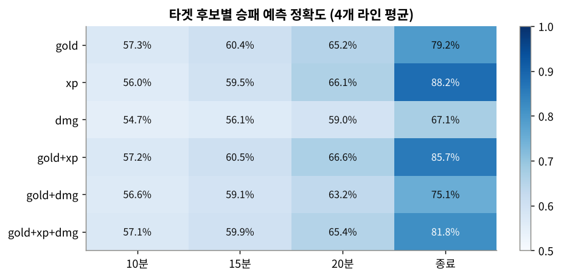
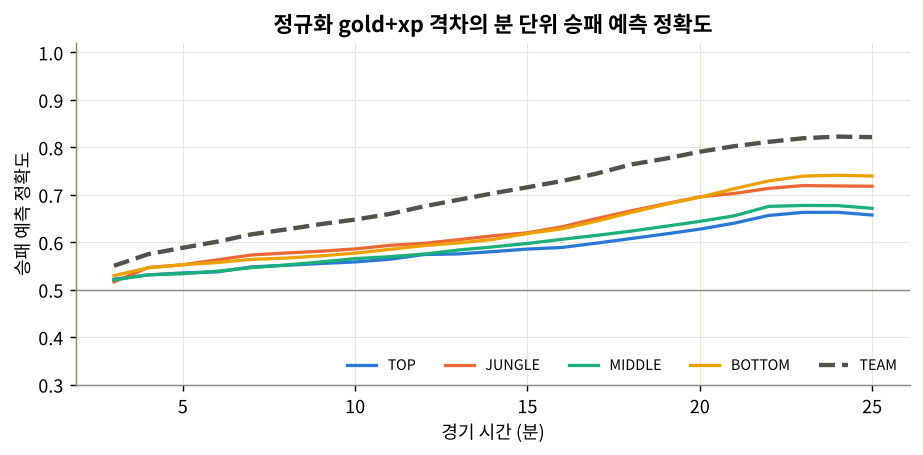
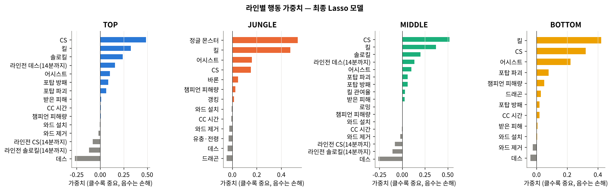
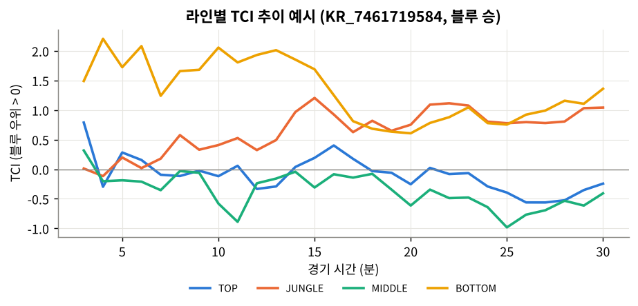
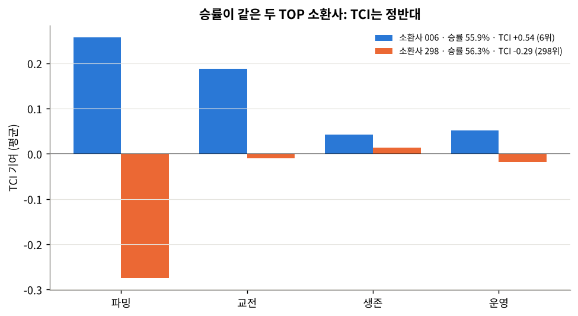

# 리그 오브 레전드 경기력 평가를 위한 설계 및 활용

## 1. 개 요

---

리그 오브 레전드(League of Legends, 이하 LoL)는 2022 항저우 아시안게임 정식 종목으로 채택될 만큼 인기와 경쟁성이 검증된 게임이다. LoL을 가장 많이 플레이하는 방식은 5대 5 솔로랭크다. 솔로랭크는 최대 2명까지만 함께 대기열에 들어갈 수 있어서, 팀원 대부분이 매 판 무작위로 정해진다. 플레이어의 목적은 개인 실력을 키워 랭크를 올리는 것이다. 최상위 티어에는 프로게이머와 스트리머도 많은데, 이들에게 솔로랭크는 실전 감각을 유지하고 경기를 준비하는 개인 연습 공간이다. 실제로 LCK의 이상혁(Faker) 선수는 솔로랭크를 하지 못해 다른 팀보다 대회 준비에 불리했다고 말한 적이 있다[[1]](https://www.gamevu.co.kr/news/articleView.html?idxno=32152).

그래서 솔로랭크를 분석할 때 단순히 승패를 맞히거나 팀워크를 분석하는 것은 잘 맞지 않는다. 승패는 무작위로 정해진 팀원 9명의 영향을 크게 받고, 팀은 매 판 새로 구성되기 때문이다. 그보다는 경기 중에 **각 라인에서 누가 얼마나 앞섰는지**를 숫자로 보여 주는 것이 더 의미 있다. 이 보고서는 라인별 경기력을 1분 단위로 나타내는 모델을 만들고, 그 모델이 얼마나 정확한지 확인한다.

### 1.1 분석 데이터

LoL 개발사인 Riot Games는 개발자 사이트에서 경기 데이터를 무료로 제공한다[[2]](https://developer.riotgames.com/apis#match-v5). 이 연구는 두 가지 데이터를 함께 사용한다.

- **match 데이터**: 경기 결과와 선수별 최종 기록
- **timeline 데이터**: 1분마다 찍힌 선수 상태(골드, 경험치, CS 등)와, 킬·와드·포탑 같은 사건 기록

분석 데이터는 2025년 1월 8일부터 4월 7일까지 한국 서버 챌린저 300명(2025년 4월 8일 기준)이 플레이한 53,279경기다. 이 중 20분 이상 진행된 **38,075경기**를 분석했다. 경기 평균 길이는 28.1분이고, 블루팀 승률은 52.0%다. 각 경기의 3분부터 끝날 때까지 1분마다 기록을 하나씩 뽑았기 때문에, 라인마다 약 97만 개, 전체 약 390만 개의 기록(샘플)이 만들어졌다.

모든 코드는 [GitHub 저장소](https://github.com/AHNNTAE/lol-tci)에 올려 두었다(데이터 제외). 원본 데이터는 수십 GB라서 한 번에 읽을 수 없기 때문에, 파일을 하나씩 읽으며 필요한 값만 뽑아 약 100MB짜리 파일로 줄이는 과정(`extract_features.py`)을 먼저 거쳤다.

### 1.2 경기력 평가를 위한 기본 방향

선행연구[[3]](https://www.kci.go.kr/kciportal/ci/sereArticleSearch/ciSereArtiView.kci?sereArticleSearchBean.artiId=ART003327764)는 같은 데이터로 미드라이너의 경기력을 1분 단위로 평가했다. 이 연구는 이를 4개 라인(TOP, JUNGLE, MIDDLE, BOTTOM)으로 넓혀, 라인별 **타임라인 기여도 지수**(Timeline Contribution Index, 이하 TCI)를 만든다. BOTTOM은 원거리 딜러와 서포터를 한 팀(봇 듀오)으로 보고 두 사람의 기록을 합쳤다.

TCI는 지도학습으로 만든다. 지도학습은 "문제(입력)와 정답(출력)을 많이 보여 주고 둘 사이의 관계를 배우게 하는 방법"이다. 여기서 입력은 그 라인의 행동 기록(CS, 킬, 데스, 와드, 포탑 등)이고, 정답은 그 시점에 상대보다 얼마나 성장했는지를 나타내는 값이다. 모델은 "이 정도로 행동했으면 이 정도 앞서 있다"는 관계를 배우고, 그 모델이 내놓는 값이 바로 TCI다.

### 1.3 분석 목적

이 연구의 목적은 세 가지다.

1. 승패와 상관없이 각 라인의 경기력을 1분 단위로 비교할 수 있는 지표를 만든다.
2. TCI가 어떤 행동을 얼마나 중요하게 보는지 보여 주어, 라인마다 앞서기 위해 무엇이 중요한지 설명한다.
3. TCI로 경기 흐름을 보고, 소환사의 실력을 승률보다 공정하게 평가하는 방법을 4장에서 보여 준다.

---

## 2. 변수 설정

---

### 2.1 타겟 변수 설정

지도학습을 하려면 모델이 맞혀야 할 정답, 즉 타겟 변수($y$)가 필요하다. 후보로는 1분마다 기록되는 세 가지 값을 골랐다.

- **골드**: 아이템을 살 수 있는 돈
- **경험치**: 레벨을 올리는 값
- **챔피언에게 준 피해량**

그리고 이 세 가지를 섞은 조합까지 모두 6개 후보를 만들었다. 모든 값은 "블루팀 선수 값 − 레드팀 선수 값", 즉 상대와의 차이(격차)로 계산했다. 0보다 크면 블루가 앞서 있다는 뜻이다.

**어떤 후보가 좋은지 고른 방법.** 수업 예제 코드(`evaluate_y.py`)와 같은 방식으로, "이 값이 0보다 크면 블루팀이 이긴다"고 예측했을 때 실제로 얼마나 맞는지를 38,075경기 전체로 확인했다.



| 타겟 후보 | 팀 10분 | 팀 15분 | 팀 20분 | 팀 종료 | 라인 평균 10분 | 라인 평균 15분 | 라인 평균 20분 | 라인 평균 종료 |
|---|---:|---:|---:|---:|---:|---:|---:|---:|
| 골드 | 64.4% | 71.4% | 78.7% | 98.3% | 57.3% | 60.4% | 65.2% | 79.2% |
| 경험치 | 63.1% | 69.6% | 77.4% | 97.2% | 56.0% | 59.5% | 66.1% | 88.2% |
| 피해량 | 59.8% | 64.0% | 70.5% | 86.5% | 54.7% | 56.1% | 59.0% | 67.1% |
| **골드 + 경험치** | **64.8%** | **71.6%** | **79.1%** | **98.4%** | 57.2% | **60.5%** | **66.6%** | 85.7% |
| 골드 + 피해량 | 63.5% | 69.8% | 76.8% | 95.4% | 56.6% | 59.1% | 63.2% | 75.1% |
| 골드 + 경험치 + 피해량 | 64.5% | 71.2% | 78.3% | 97.3% | 57.1% | 59.9% | 65.4% | 81.8% |

(위 그림은 라인 평균 정확도다.)

최종 정답(타겟)은 **골드 + 경험치 차이**로 정했다. 이유는 다음과 같다.

- 팀 전체(5명 합계)로 보면 골드 + 경험치가 10분, 15분, 20분, 경기 종료의 **모든 시점에서 1등**이다. 경기 종료 시점에는 98.4%의 경기에서 승패와 일치했다.
- 라인 하나만 봐도 15분과 20분에서 1등이고, 경기 종료 시점에서도 2등이다. 어느 시점에서나 고르게 좋다.
- 골드는 아이템, 경험치는 레벨로 이어진다. 둘을 합치면 "상대보다 얼마나 강해졌는가"를 가장 잘 나타낸다. 반면 피해량은 모든 시점에서 가장 낮았다. 교전을 자주 하는 챔피언이면 피해량이 많이 쌓이고, 진 싸움에서도 쌓일 수 있기 때문이다. 그래서 피해량은 정답이 아니라 입력으로 쓰기로 했다.

**골드와 경험치를 그냥 더하지 않은 이유.** 골드와 경험치는 단위가 달라서 그냥 더하면 숫자가 더 큰 골드가 결과를 좌우하게 된다. 또 격차는 시간이 갈수록 커진다. 예를 들어 TOP에서 보통 벌어지는 골드 차이는 5분에 약 370골드, 15분에 약 1,460골드, 25분에 약 2,380골드다. 그래서 같은 500골드 차이라도 5분에는 큰 차이이고, 25분에는 작은 차이다.

이 문제를 풀기 위해 **"그 시간대에 보통 벌어지는 차이"로 나눠** 같은 눈금으로 맞췄다. 예를 들어 5분에 370골드 앞서 있으면 1.0, 25분에 2,380골드 앞서 있어도 1.0이 된다. 골드와 경험치를 각각 이렇게 바꾼 뒤 평균을 낸 것이 최종 정답 $y$다. 시험 점수를 평균 대비 몇 점 위인지로 비교하는 z-score와 비슷한 아이디어인데, 평균은 빼지 않고 나누기만 했다. 그래야 0이 "상대와 대등"이라는 뜻을 그대로 유지하기 때문이다. 1–2분은 아직 차이가 거의 0이라 제외했다.

아래 그림은 골드 + 경험치 차이로 승패를 맞힌 정확도를 1분마다 그린 것이다. 팀 전체는 시간이 갈수록 올라 25분쯤 약 82%가 되고, 라인 하나만으로는 66–74%까지 올라간다. 한 라인이 이겨도 다른 라인이 지면 경기는 질 수 있으니, 라인 하나의 정확도가 팀보다 낮은 것은 자연스럽다. 이것이 바로 승패와 따로 라인별 지표가 필요한 이유다.



### 2.2 라인별 피처 설정

피처($\vec{x}$)는 모델에 넣는 입력값이다. 수업 예제 코드(`data_process_sample.py`)가 쓴 방식 그대로, 모든 입력을 "경기 시작부터 그 시점까지 쌓인 값의 차이(블루 − 레드)"로 통일했다. 이를 **누적 격차**라고 부른다. 이 방식을 고른 이유는 세 가지다.

1. 정답(골드 + 경험치 차이)도 같은 방식이라 입력과 정답이 짝이 맞는다.
2. "최근 1분 동안"만 보면 대부분 0이라 정보가 거의 없다.
3. "지금까지 쌓아 온 차이"라서 뜻이 분명하다.

예제 코드는 10분 한 시점만 사용했는데, 이를 다음과 같이 바꿨다(`tci_lane/data_process.py`).

1. 3분부터 경기가 끝날 때까지 **1분마다** 기록을 뽑았다.
2. 킬, 데스, 어시스트, 와드, 포탑 같은 사건은 그 시점 이전에 일어난 것만 세었다. 미래 정보가 섞이지 않게 하기 위해서다.
3. 서포터는 원거리 딜러와 합쳐 BOTTOM으로 묶었다.
4. **골드와 경험치는 입력에서 뺐다.** 정답에 들어간 값을 입력으로 주면 모델이 답을 베끼게 되기 때문이다.

라인마다 역할이 다르므로, 모든 라인이 공통으로 쓰는 입력에 라인별 입력을 더했다.

| 구분 | 입력(피처) | 이유 |
|---|---|---|
| 공통 | 시간, CS, 챔피언 피해량, 킬, 데스, 어시스트, CC(군중 제어) 시간, 와드 설치, 와드 제거 | CS·킬·어시스트는 골드와 경험치를 버는 방법이고, 데스는 죽어 있는 동안 성장을 놓치는 손해다. 피해량과 CC는 싸움에서의 기여, 와드는 시야 싸움이다. |
| TOP | + 솔로킬, 받은 피해, 포탑 방패, 포탑 파괴, 공허 유충·전령 | 혼자 상대와 맞서는 1:1 라인이라 솔로킬과 포탑 압박이 중요하다. 유충과 전령은 탑 근처 오브젝트다. |
| JUNGLE | + 정글 몬스터 처치(정글 CS), 드래곤, 공허 유충·전령, 바론 | 정글러는 정글 몬스터와 갱킹으로 성장하고, 큰 오브젝트를 챙기는 것이 핵심 역할이다. |
| MIDDLE | + 솔로킬, 받은 피해, 포탑 방패, 포탑 파괴 | 1:1 싸움과 다른 라인으로의 지원(로밍)이 번갈아 일어난다. |
| BOTTOM | + 받은 피해, 포탑 방패, 포탑 파괴, 드래곤 | 2:2 라인이라 싸움이 잦고, 드래곤 싸움과 가깝다. |

입력값도 정답처럼 **그 시간대의 보통 차이로 나눠** 같은 눈금으로 맞추는 방법을 함께 시험했다. "5분의 CS 10개 차이"와 "25분의 CS 10개 차이"는 의미가 다르기 때문이다. 3장에서 그대로 쓴 경우와 나눠 준 경우를 비교했다.

---

## 3. 경기력 지표 모델링

---

### 3.1 모델 선정

입력은 숫자 13–14개이고 정답은 숫자 하나이므로, 이 문제는 숫자를 예측하는 **회귀 문제**다. 간단한 모델부터 복잡한 모델까지 같은 조건에서 비교했다.

| 종류 | 모델 | 쉽게 말하면 |
|---|---|---|
| 기준선 | 평균 | 항상 평균값만 말하는 모델. 이것보다 못하면 의미가 없다. |
| 선형 회귀 | LinearRegression, Ridge, Lasso | 입력마다 가중치(점수)를 곱해서 더한다. Ridge와 Lasso는 가중치가 너무 커지지 않게 벌점을 준다. |
| 거리 기반 | KNN | 가장 비슷한 과거 기록 15개의 정답을 평균 낸다. |
| 나무 모델 | RandomForest | "CS 차이가 10개 이상인가?" 같은 질문을 이어 가는 나무 300그루의 답을 평균 낸다. |
| 부스팅 | HistGradientBoosting (LightGBM과 같은 방식) | 앞의 나무가 틀린 부분을 다음 나무가 고쳐 가며 순서대로 쌓는다. |
| 신경망 | MLP | 사람 뇌를 흉내 낸 층 2개짜리 신경망 |

**공정하게 비교하는 방법.** 같은 경기의 1분, 2분, 3분 기록은 서로 아주 비슷하다. 그래서 기록을 무작위로 나누면 같은 경기가 공부용과 시험용에 동시에 들어가 점수가 부풀려진다. 이를 막기 위해 **경기 단위로** 데이터를 5묶음으로 나눴다. 4묶음으로 공부하고 나머지 1묶음으로 시험 보기를 5번 돌아가며 반복했다(5-fold 교차검증). 모델 비교는 시간이 오래 걸려서 무작위로 고른 2,000경기로 했고, 최종으로 고른 모델은 38,075경기 전체로 다시 검증했다.

**얼마나 정확한지 재는 방법.** 예측값과 실제 정답의 차이(오차)로 다음 값을 계산했다.

- **MSE**: 오차를 제곱해서 평균 낸 값. 작을수록 좋다.
- **RMSE**: MSE의 제곱근. 오차의 크기를 원래 단위로 보여 준다. 작을수록 좋으며, 이 값으로 모델을 골랐다.
- **MAE**: 오차의 절댓값 평균. 작을수록 좋다.
- **R²(결정계수)**: 정답이 오르내리는 것을 몇 %나 설명했는지. 1에 가까울수록 좋다.

여기서 오차 1.0은 "그 시간대에 보통 벌어지는 차이 하나만큼 틀렸다"는 뜻이다.

**비교 결과 (2,000경기, RMSE, 낮을수록 좋음).** "원래 값"은 입력을 그대로 쓴 경우, "시간 맞춤"은 입력도 그 시간대의 보통 차이로 나눠 준 경우다.

| 모델 | TOP 원래 값 | TOP 시간 맞춤 | JUNGLE 원래 값 | JUNGLE 시간 맞춤 | MIDDLE 원래 값 | MIDDLE 시간 맞춤 | BOTTOM 원래 값 | BOTTOM 시간 맞춤 |
|---|---:|---:|---:|---:|---:|---:|---:|---:|
| 평균 (기준선) | 0.921 | 0.921 | 0.896 | 0.896 | 0.900 | 0.900 | 0.907 | 0.907 |
| LinearRegression | 0.438 | 0.319 | 0.445 | 0.277 | 0.456 | 0.344 | 0.489 | 0.380 |
| Ridge | 0.438 | 0.319 | 0.445 | 0.277 | 0.456 | 0.344 | 0.489 | 0.380 |
| **Lasso** | 0.438 | **0.319** | 0.445 | **0.277** | 0.456 | **0.344** | 0.489 | **0.380** |
| KNN | 0.385 | 0.384 | 0.383 | 0.379 | 0.422 | 0.425 | 0.436 | 0.437 |
| RandomForest | 0.348 | 0.333 | 0.315 | 0.298 | 0.375 | 0.363 | 0.400 | 0.391 |
| 부스팅 (LightGBM 계열) | 0.329 | 0.320 | 0.296 | 0.277 | 0.359 | 0.346 | 0.389 | 0.382 |
| MLP (신경망) | 0.372 | 0.358 | 0.303 | 0.302 | 0.396 | 0.391 | 0.434 | 0.426 |


이 결과에서 알 수 있는 점은 세 가지다.

1. **입력도 시간에 맞춰 주면 모든 라인에서 오차가 줄었다.** 특히 선형 모델의 효과가 컸다(JUNGLE 0.445 → 0.277). 입력을 그대로 쓰면 "같은 CS 10개 차이가 시간에 따라 다른 의미"라는 점을 선형 모델이 이해하지 못하기 때문이다. 입력과 정답을 같은 눈금으로 맞추자 관계가 단순해졌다.
2. **시간을 맞춘 뒤에는 간단한 선형 모델과 복잡한 부스팅의 정확도가 거의 같다.** 차이가 0.001–0.002밖에 나지 않는다. 롤의 성장은 "CS·킬·어시스트가 쌓여 골드와 경험치가 된다"는 더하기 구조라서, 복잡한 모델이 추가로 찾아낼 것이 거의 없었다는 뜻이다.
3. 그래서 정확도가 같다면 **이유를 설명할 수 있는 Lasso**를 4개 라인 모두의 최종 모델로 골랐다. 4개 라인이 같은 모델을 쓰니 라인끼리 비교하기도 쉽다.

**최종 모델: Lasso 회귀는 어떻게 작동하나.** Lasso는 아주 단순하다. 행동마다 가중치(점수)가 있고, 각 행동의 차이에 가중치를 곱해 모두 더한 값이 TCI다.

> TCI = (CS 차이 × 가중치) + (킬 차이 × 가중치) + (데스 차이 × 가중치) + … + 기본값

실제 경기의 15분, 블루팀 정글러를 예로 들면 다음과 같다.

| 행동 (블루 − 레드) | 차이 | TCI에 더해진 값 |
|---|---:|---:|
| 정글 몬스터 처치 | +34개 | +0.90 |
| 라인 미니언 처치 | +8개 | +0.17 |
| 어시스트 | +2 | +0.12 |
| 데스 (3번 덜 죽음) | −3 | +0.05 |
| 나머지 행동 | | −0.04 |
| **합계 = TCI** | | **1.21** (실제 정답 1.07) |

가중치는 컴퓨터가 정한다. 약 97만 개의 기록에서 "예측과 정답의 차이"가 가장 작아지도록 가중치를 조금씩 바꿔 가며 찾는다. Lasso는 여기에 "가중치가 클수록 벌점"이라는 규칙을 하나 더한다. 그래서 별로 도움이 안 되는 행동은 가중치가 정확히 0이 되어 자동으로 빠진다. 데이터가 30경기뿐이던 예비 실험에서는 입력의 절반 가까이가 0이 되었고, 38,075경기 전체에서는 데이터가 충분해 대부분의 입력이 남았다.

### 3.2 모델링 결과

최종 모델을 38,075경기 전체로 5-fold 교차검증한 결과다. 시험 문제는 항상 공부에 쓰지 않은 경기였다.

| 라인 | MSE | RMSE | MAE | R² | 평균만 말했을 때 RMSE |
|---|---:|---:|---:|---:|---:|
| TOP | 0.097 | 0.311 | 0.241 | 0.886 | 0.920 |
| JUNGLE | 0.076 | 0.276 | 0.215 | 0.905 | 0.896 |
| MIDDLE | 0.120 | 0.346 | 0.271 | 0.852 | 0.899 |
| BOTTOM | 0.143 | 0.379 | 0.296 | 0.825 | 0.905 |


(가로축은 실제 정답, 세로축은 예측값이다. 점이 대각선에 모일수록 잘 맞힌 것이다. 라인마다 6,000개만 표시했다.)

네 라인 모두 R²가 0.83–0.91이다. 골드와 경험치를 직접 보지 않고 **행동 기록만으로 성장 차이의 83–91%를 설명**한다는 뜻이다. 오차(RMSE)는 평균만 말하는 경우보다 약 58–69% 작다. 실제 단위로 바꾸면, 15분 TOP에서 오차는 골드 약 460 정도다.

- **JUNGLE이 가장 정확하다.** 정글러는 정글 몬스터와 킬처럼 성장 방법이 단순하기 때문이다.
- **BOTTOM이 가장 어렵다.** 원거리 딜러와 서포터 두 명을 합쳤고, 서포터는 아이템으로 버는 골드 등 입력에 잡히지 않는 부분이 있기 때문이다.
- **20분 이후에는 모든 라인에서 오차가 조금 커진다.** 후반에는 라인이 섞이고 한타·바론처럼 라인 밖의 일이 많아지며, 오래가는 경기 자체가 적기 때문이다.



**라인별로 중요한 행동 (가중치가 클수록 중요).**

| 행동 | TOP | JUNGLE | MIDDLE | BOTTOM |
|---|---:|---:|---:|---:|
| CS (라인 미니언) | **0.431** | 0.153 | **0.463** | 0.321 |
| 정글 몬스터 | – | **0.534** | – | – |
| 킬 | 0.329 | 0.482 | 0.394 | **0.423** |
| 어시스트 | 0.107 | 0.169 | 0.120 | 0.223 |
| 데스 | −0.131 | −0.037 | −0.136 | −0.040 |
| 솔로킬 | 0.111 | – | 0.096 | – |
| 포탑 파괴 | 0.081 | – | 0.068 | 0.079 |
| 포탑 방패 | 0.046 | – | 0.033 | 0.021 |
| 챔피언 피해량 | 0.000 | 0.025 | −0.003 | 0.051 |
| 와드 제거 | −0.016 | −0.025 | −0.022 | −0.023 |

(– 는 그 라인에서 쓰지 않은 입력. 나머지 입력은 가중치가 0.05보다 작아 표에서 뺐다. 전체 값은 `results_full/final_coefficients.csv`에 있다.)

가중치는 각 라인의 역할과 잘 맞는다.

- **TOP**: CS가 가장 중요하고, 솔로킬이 따로 의미가 있다. 데스의 손해도 크다. 혼자 싸우는 라인이라 한 번 죽으면 손해가 크다.
- **JUNGLE**: 정글 몬스터와 킬이 둘 다 크다. 동선 관리와 갱킹 성공이 함께 중요하다. 죽어도 라인 CS를 놓치지 않아서 데스의 손해는 작다.
- **MIDDLE**: CS와 킬이 중심이다. TOP보다 킬과 어시스트 비중이 커서, 다른 라인을 도와주러 가는 로밍의 영향이 보인다.
- **BOTTOM**: CS보다 킬이 더 중요하고, 어시스트와 피해량도 다른 라인보다 크다. 2:2 싸움이 잦은 라인이기 때문이다.

가중치는 "함께 움직이는 경향"을 보여 줄 뿐, 원인과 결과를 증명하지는 않는다. 예를 들어 와드 제거가 모든 라인에서 아주 작은 마이너스인 것은 와드를 지우러 다니는 시간만큼 CS를 놓친다는 뜻일 수 있지만, 값이 작아서 크게 해석하지 않았다.

**TCI가 승패와 얼마나 관련 있나.** 15분의 TCI만으로 승패를 구분하는 정도(AUC, 0.5면 동전 던지기, 1이면 완벽)는 TOP 0.62, JUNGLE 0.67, MIDDLE 0.64, BOTTOM 0.66이다. 실제 골드 + 경험치 차이로 구분했을 때와 거의 같다. 즉 TCI는 골드와 경험치를 보지 않고도 그 정보를 그대로 담고 있다. 라인 하나만으로 0.6대에 머무는 것은 솔로랭크 승패가 10명 전체의 결과이기 때문이다.

**한계.**

1. 모델 비교는 2,000경기로 한 번만 했기 때문에, 차이가 0.002 이하인 모델끼리는 우열을 가릴 수 없다.
2. 같은 기간의 경기로만 검증했으므로, 다른 패치나 다른 티어에서도 잘 맞는지는 따로 확인해야 한다.
3. TCI는 "상대보다 얼마나 앞섰나"이지 절대적인 실력이 아니다.
4. 챔피언 상성과 조합은 반영하지 않았다.

---

## 4. TCI 모델의 활용

### 4.1 한 경기 들여다보기

라인별 TCI를 1분마다 그리면, 어느 라인이 언제 앞섰고 언제 뒤집혔는지 한눈에 보인다. 0보다 위면 블루가 앞선 것이다.



위 경기(KR_7461719584)는 블루팀이 이겼다.

- **BOTTOM**: 15분까지 크게 앞섰고(TCI 1.2–2.2), 17–20분에 조금 줄었다가 다시 벌려 30분에 1.36으로 끝났다.
- **JUNGLE**: 0 근처에서 시작해 15분 1.21까지 꾸준히 앞서 나갔다.
- **TOP**: 경기 내내 비슷했고, 26–27분에는 −0.48까지 밀렸다.
- **MIDDLE**: 거의 내내 밀렸다(11분 −0.87, 25분 −1.02).

즉 이 경기는 바텀과 정글이 이끈 경기이고, **블루 미드라이너는 이겼지만 라인전에서는 밀렸다.** 25분의 −1.02를 행동별로 나눠 보면 그중 −0.97이 CS 69개 차이 때문이었다. 이 미드라이너가 고쳐야 할 점이 CS 관리라는 것을 바로 알 수 있다. 또 그래프가 갑자기 꺾이는 시점(예: BOTTOM 15–17분)은 리플레이에서 다시 볼 장면으로 쓸 수 있다.

### 4.2 소환사의 실력을 TCI로 평가하기

TCI의 최종 목적은 승패와 상관없이 **소환사의 실력을 객관적으로 설명**하는 것이다. 분석 대상 챌린저 299명(`puuid_challengers.txt`)에 대해 다음과 같이 계산했다.

1. 그 소환사가 참여한 경기마다, 그 소환사 입장에서 본 라인 TCI를 구한다. 레드팀이면 부호를 바꿔, 내가 앞서면 +가 되게 한다.
2. 10–20분 평균을 그 경기의 **라인전 TCI**로 정한다.
3. 주로 가는 라인의 경기들에서 라인전 TCI를 평균 낸 것이 그 소환사의 TCI다.

299명 모두 30경기 이상 기록이 있었다(중간값 226경기). 이름 대신 TCI 순위에 따라 "소환사 001–299"로 익명 처리했다(`analyze_players.py`, 결과는 `results_players/`).

**결과 1: 승률은 운을, TCI는 실력을 잰다.**

실력을 재는 지표라면, 같은 사람의 경기를 반으로 나눠 따로 계산해도 비슷한 값이 나와야 한다. 그래서 각 소환사의 경기를 홀수 번째와 짝수 번째로 나누고, 두 묶음의 값이 얼마나 일치하는지(상관계수, 1에 가까울수록 일치)를 비교했다.

| 지표 | 홀수 번째 경기와 짝수 번째 경기의 일치도 |
|---|---:|
| 승률 | 0.12 |
| **라인전 TCI** | **0.79** |


승률은 같은 사람인데도 두 묶음이 거의 맞지 않았다(0.12). 한 판의 결과가 이기거나 지는 것 하나뿐이고, 무작위로 만난 팀원 9명의 영향이 크게 섞이기 때문이다. 반면 라인전 TCI는 0.79로 잘 맞았다. 매 분의 행동 기록을 쓰고 팀원의 영향이 적은 라인 지표이기 때문이다. 즉 **승률은 운이 많이 섞인 결과이고, TCI는 그 사람이 꾸준히 가진 실력에 더 가깝다.**

TCI와 승률의 관계는 0.20으로, TCI가 높은 사람이 대체로 더 많이 이기기는 하지만 승률만으로는 보이지 않는 차이가 크다. 299명 중 258명의 TCI가 0보다 컸다(평균 +0.16). 챌린저는 대부분 라인 상대보다 앞선다는 자연스러운 결과다. 그중 13명은 라인전을 이기면서도 승률이 50%보다 낮았다.


**결과 2: 승률이 같아도 실력의 모습은 정반대일 수 있다.**

같은 라인, 150경기 이상, 승률 차이 1%p 이내인 두 사람 중 TCI 차이가 가장 큰 두 TOP 소환사를 비교했다.

| | 경기 수 | 승률 (299명 중 순위) | 라인전 TCI (순위) | 파밍 | 교전 |
|---|---:|---:|---:|---:|---:|
| 소환사 006 | 152 | 55.9% (129위) | **+0.55 (6위)** | +0.27 | +0.18 |
| 소환사 298 | 309 | 56.3% (116위) | **−0.30 (298위)** | −0.29 | −0.01 |



두 사람은 승률로는 구별되지 않지만, TCI로는 거의 양 끝에 있다. Lasso는 "행동별 점수의 합"이라서 TCI를 파밍(CS·정글 몬스터), 교전(킬·어시스트·솔로킬·피해량·CC), 생존(데스·받은 피해), 운영(포탑·오브젝트·와드)으로 나눠 볼 수 있다.

- **소환사 006**: CS와 교전 모두 상대보다 앞선다. "라인전으로 이기는" 유형이다.
- **소환사 298**: CS를 크게 내주면서도, 한타나 운영처럼 라인 밖에서 이기는 유형이다.

이처럼 TCI는 **누가 라인전을 더 잘하는지**뿐 아니라 **어떻게 이기는지**까지 보여 준다. 298에게는 "CS 손해를 줄이면 승률을 더 올릴 수 있다"는 구체적인 조언이 된다.

**주의할 점.** BOTTOM은 원거리 딜러와 서포터가 같은 봇 듀오 TCI를 공유하므로, 개인보다 듀오 평가에 가깝다. 또 챌린저의 라인 상대는 대체로 더 낮은 티어이므로, TCI의 절대값보다 소환사끼리의 비교에 의미를 두어야 한다.

### 4.3 그 밖의 활용

- **행동별 피드백**: TCI는 행동별 점수의 합이라서, 한 경기에서도 "15분 TOP TCI −0.8 중 CS 차이가 −0.5, 데스가 −0.3"처럼 무엇 때문에 밀렸는지 바로 설명할 수 있다.
- **실시간 게이지**: TCI는 매 분 기록만으로 계산되므로, 관전·방송 화면에 라인별 우위 게이지로 띄울 수 있다.
- **앞으로 해 볼 것**: 챔피언별 TCI로 숙련도를 비교하거나, 이전 몇 분의 흐름까지 반영하는 모델로 발전시키고, 다른 패치·기간의 데이터로 다시 검증해 볼 수 있다.

---

### 참고문헌 및 자료

1. 김지만, “[LCK 현장] 패배한 페이커, ‘솔로랭크가 막혀 준비에 아쉬움 있었다’”, 게임뷰, 2024.04.04. https://www.gamevu.co.kr/news/articleView.html?idxno=32152
2. Riot Games Developer Portal, MATCH-V5 API. https://developer.riotgames.com/apis#match-v5
3. 선행연구 (KCI). https://www.kci.go.kr/kciportal/ci/sereArticleSearch/ciSereArtiView.kci?sereArticleSearchBean.artiId=ART003327764
4. Tibshirani, R. (1996). Regression Shrinkage and Selection via the Lasso. *Journal of the Royal Statistical Society: Series B*, 58(1), 267–288.
5. Pedregosa, F. et al. (2011). Scikit-learn: Machine Learning in Python. *JMLR*, 12, 2825–2830.

### 재현

모든 코드는 GitHub 저장소(https://github.com/AHNNTAE/lol-tci)에 있다(데이터 제외). 아래 명령으로 이 보고서의 표와 그림을 다시 만들 수 있다.

```bash
pip install -r requirements.txt
python extract_features.py --data match_data --workers 2      # 원본 데이터 → 분 단위 입력값 파일 (약 6분)
python run_all.py --features results/minute_features_full.csv.gz \
                  --end results/end_of_game_full.csv.gz --out results_full
python extract_players.py --data match_data --workers 2         # 경기별 소환사 정보
python analyze_players.py                                       # 4.2절 소환사 분석
```

30경기 예비 실험 결과는 `results/` 폴더에 남겨 두었다(`python run_all.py --data data --out results`).
